# Doom9tr için denoising filter çalışmam

> **Arşiv Notu:** Bu yazıyı, 2005 yılı sonunda **doom9tr.org** forumunda moderatörlük yaptığım dönemde yazdım. Orijinal platform artık yayında olmadığı için kendi arşivimde sakladığım bu dökümanı aslına sadık kalarak GitHub Pages'e yüklüyorum.

Bu başlığa, Gordian Knot ile rip yaparken denediğim denoising filtrelerinin sonuçlarını yazacağım. Başlık ortak olup benzer denemelerde bulunan arkadaşların da yaptıkları denemelerin sonuçlarını burada paylaşmaları çok faydalı olacaktır.

Bu hafta içinde The Core (http://imdb.com/title/tt0298814/) filmi üzerinde 3 farklı avs script ile encode denemeleri yaptım. Bu filmi seçmemdeki öncelikli neden filmin bol miktarda görsel efekt içermesiydi. Denoising filtrelerini doğrudan avs script'inin içine yazıyorum. Öncelikle, bilmeyenler için denoising filtrelerinin avs script'e nasıl yazıldığını tarif edeceğim:

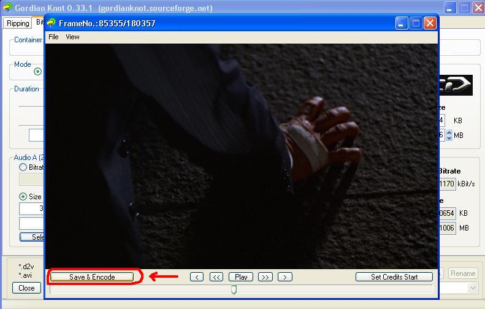

Gordian Knot sekmelerindeki tüm ayarlarımızı tamamladıktan sonra, üstteki resimdeki gibi `Save & Encode`’a tıklıyoruz.

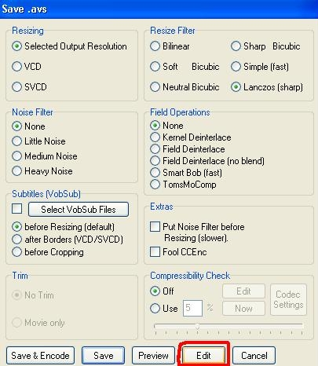

Açılan, .avs dosyamızı kaydedeceğimiz pencerede `Edit` butonuna tıklıyoruz.

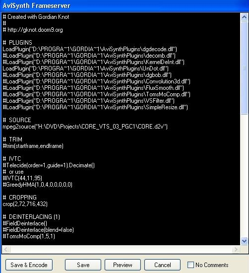

Yukarıdaki gibi, kod içeren bir pencere açılacak. Bu kod, daha doğrusu script Gordian Knot’un standart yazdığı script’tir. Dikkatli bakılırsa crop içindeki değerlerin bizim Gordian Knot arayüzünü kullanarak siyah bandı keserken elde ettiğimiz değerler olduğu görülebilir. Gordian Knot, arayüzü kullanarak yaptığımız bazı ayarları kendisi avisynth içine ekler. Satır başlarındaki `#` işareti, o satırdaki script’in yorum içine alındığını yani geçersiz olduğunu, çalıştırılmayacağını gösteriyor. Şayet geçerli olmasını istersek `#` işaretini silmemiz yeterli. Script penceresi ile çalışmamız bittiğinde ise "Save&Encode"'a basarak çıkacağız.

Yukarıda üç farklı encode denemesinde bulunduğumdan bahsetmiştim. 

Birincisinde hiçbir script kullanmadım. Daha doğrusu, yukarıdaki resimdeki script’e hiçbir müdahalede bulunmayarak Gordian Knot'un default ürettiği script'i kullandım. Encode işlemi 5 saat 12 dakika 57 saniye sürdü.

İkinci encode denememde aşağıdaki script'i kullandım.

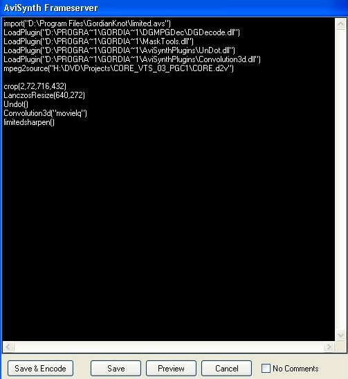

İkinci encode 16 saat 40 dakika 16 saniye sürdü.

İkinci denememe ait script'te, `Convolution3d` ve `limitedsharpen` filtrelerinin kullanıldığı görülebilir. `Convolution3d` filtresi, her bir film karesindeki piksele 3D helezon uygular ve farklı kullanımları şekilleri vardır.

| Filtre | Açıklama |
| ------ | -------- |
| Convolution3d("movieHQ") | Kalitesi yüksek DVD’lerde kullanılır. |
| Convolution3d(“movieLQ") | Kalitesi düşük DVD’lerde kullanılır. |
| Convolution3d("animeHQ") | Çizgi filmlerde, DVD kalitesi yüksekse kullanılır. |
| Convolution3d("animeLQ") | Çizgi filmlerde, DVD kalitesi düşükse kullanılır. |
| Convolution3d("animeBQ") | Çizgi filmlerde, DVD kalitesi kötüyse kullanılır. |
| Convolution3d("vhsBQ") | Kötü kaliteli VHS kaynaklarında kullanılır. |

`limitedsharpen` ise görüntüyü keskinleştirir. Denemelerimde `limitedsharpen`’dan kalite anlamında çok faydalandım ancak bu filtrenin kullanımı encode süresini 3-4 kat uzatabilir. Yukarıda belirttiğim ikinci encode’un yaklaşık onaltı buçuk saat sürmesinin temel nedeni `limitedsharpen`’ın kullanılmış olmasıdır.

Üçüncü encode denememde, sonuçları karşılaştırabilmek için Convolution3d filtresinin ("movieHQ") parametresini denedim. Bu denemeye ait kullandığım script aşağıdaki gibidir.

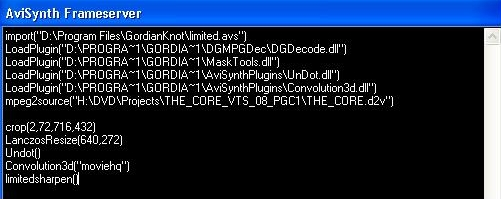

Bu deneme 17 saat 49 dakika 41 saniye sürdü.

Şimdi sonuçları görebilmek ve karşılaştırma yapabilmek için üç ayrı rip’in beşer adet SS’ini aşağıya koyuyorum. SS’ler, yukarıda anlattığım sırada olacak, yani, aynı frame'e ait ilk SS hiçbir script kullanmadığım, ikinci SS `Convolution3d(“movielq)` ile `limitedsharpen` kullandığım, üçüncü SS ise Convolution3d(“moviehq") ile `limitedsharpen` kullandığım rip’lere aittir.

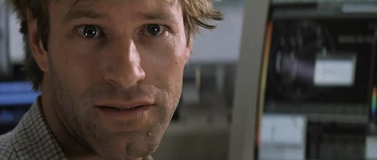
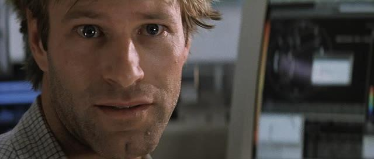

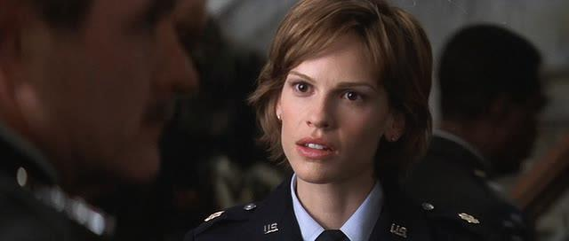
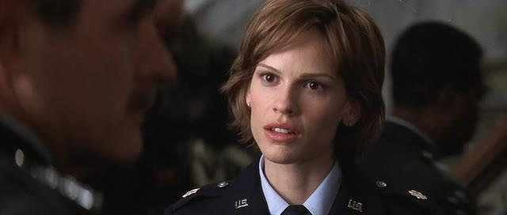

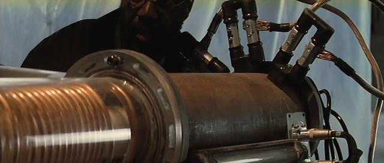

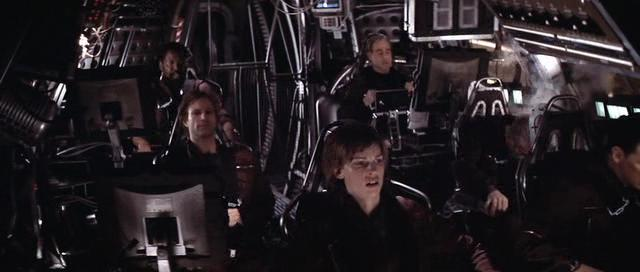
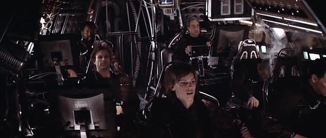
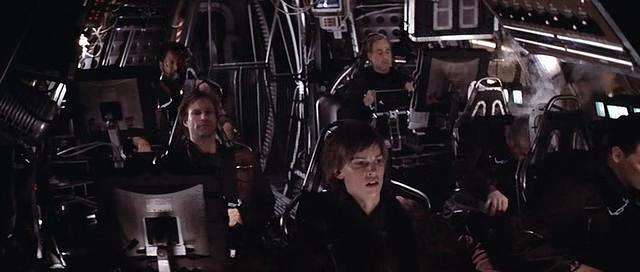

Kullandığım script'lerin etkisini görebilmek için SS'leri acdsee ile art arda oynatıyorum. Böylece fark belirgin şekilde ortaya çıkıyor.

Bu çalışmamda görüntü kalitesini yukarı çekebilmek için yukarıda da bahsettiğim iki filtreyi kullandım: `convolution3d` ve `limitedsharpen`. LimitedSharpen aslında bir filtre değil, bir script'tir ve bu nedenle, LoadPlugin yerine import ile script'e dahil edilir. 

## Filtre Linkleri
Filtre dosyalarını incelemek için [warpenterprises](http://www.avisynth.nl/users/warpenterprises/), avisynth hakkında bilgi için [avisynth.nl](http://www.avisynth.nl/) adresleri faydalı olacaktır.  

convolution3d
[https://web.archive.org/web/2016/http://www.avisynth.nl/users/warpenterprises/files/convolution3d_25_dll_20030422.zip](https://web.archive.org/web/2016/http://www.avisynth.nl/users/warpenterprises/files/convolution3d_25_dll_20030422.zip)

MaskTools, LimitedSharpen'ın çalışmak için ihtiyaç duyduğu çekirdek eklentidir.
[https://web.archive.org/web/2008/http://manao4.free.fr/MaskTools-v1.5.8.zip](https://web.archive.org/web/2008/http://manao4.free.fr/MaskTools-v1.5.8.zip)

LimitedSharpen Script'i. (Dosya yolu, avisynth script'i başında import edilerek kullanılır)
[LimitedSharpen.avsi](./scripts/LimitedSharpen.avsi)

İyi çalışmalar.