# DVD’DEN DIVX YAPIMI (ADIM ADIM)

## GEREKLİ PROGRAMLAR VE LİNKLERİ

1. [GordianKnot Rip Pack v.0.33.1](http://prdownloads.sourceforge.net/gordianknot/GordianKnot.RipPack.0.33.1.Setup.exe?download )
2. [Gordian Knot Codec Pack 1.9](http://prdownloads.sourceforge.net/gordianknot/Gordian.Knot.Codec.Pack.1.9.Setup.exe?download)

**Gordian Knot Rip Pack içindeki programlar:**

- **Gordian Knot**
	- DVDDecrypter
	- DGIndex
	- VirtualDubMod
	- Nandub
	- robot4rip
	- BeSweet
	- vStrip

**Adım adım izleyeceğimiz yol:**

1. robot4rip’i açıp tüm ayarlarını yapacağız. Ardından seçili ayarlarla robotu çalıştırıp DVD’den DivX’e Encoding için gerekli ön-malzemeyi oluşturacağız.
2. Gordian Knot arayüzü ile gerekli ayarları yapacağız.

---

Rip paketini kurduktan sonra robot4rip’i açalım.

Aşağıdaki şekilde açılacak.

robot4rip'in ana penceresi yukarıdaki gibi. (Programdaki yazılı bilgiler benim son çalışmamdan kalanlar)

İlk kullanımda ayarları yapmamız gerekiyor. Bunun için `Tools > Preferences` yolunu izleyeceğiz.

Preferences ekranı 8 sekmeden oluşuyor. Gordian Knot Rip Pack `v.0.33’teki bir bug’dan dolayı` robot4rip ile kullanacağım tüm entegre programların yolları hatalı gösterilmiş. Adım adım sekmeleri ayarlarken hatalı yolları da (path) kesinlikle düzeltmeliyiz.

Sırasıyla başlayalım. Soldan birinci sekme, `Folders` sekmesinde yaratılacak `ISO dosyası`, `Full Copy` dosyası, `Vob`’ların konulacağı klasör ve proje klasörünün yollarını gösterelim. Burada, kendi makinamda h: sürücüsünün root’unu kök klasör olarak atıyorum. Buradaki klasör atamaları programın default olarak ileride kullandığı klasörler olup sonradan aynı yerden istenildikleri gibi değiştirilmeleri mümkün.

Yukarıdaki resimdeki gibi `Replace [space] with “_” in Project Title (recommended)` seçili olacak.

`Full Copy / ISO Image` sekmesinde, **1** numara ile işaretlenen ayarda DVD’deki dosyaları harddiske `tam kopya` mı alacağımızı yoksa `Daemon Tools` ile `ISO image`’ini mi yapacağımızı seçiyoruz. Resimdeki gösterildiği gibi `Copy all files to a harddisk folder (Full Copy)` seçili olacak. **2 numara** ile işaretlenen ayarda, DVD dosyalarını DVD’den HDD’ye çıkaracak `DVDDecrypter.exe` programının diskteki yolunu doğru gösterelim. Bunun için adresin solundaki küçük klasör ikonuna tıklamamız yeterli. Altındaki `Daemon Tool` ayarlarını ellemiyoruz.

PGC Rip sekmesinde ayarlar yukarıdaki gibi olacak. Vstrip’in yol ifadesinin doğru olduğunu kontrol edelim.

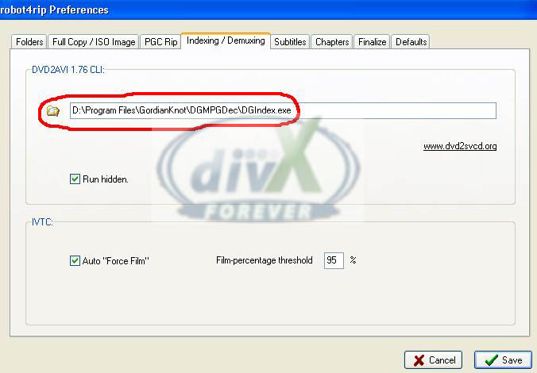

Indexing/Demuxing sekmesinde DVD2AVI’nin yolunu gösterirken Gordian Knot 0.33 versiyonu için yeni geliştirilmiş DGIndex.exe programının yolunu göstereceğiz. Diğer ayarlar yukarıdaki gibi olacak.

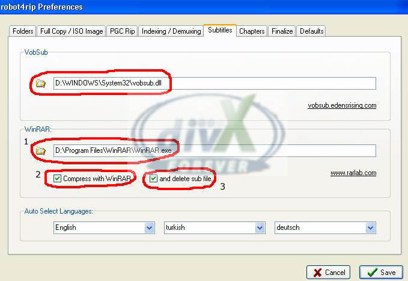

Subtitles sekmesinde `vobsub.dll` dosyasının yolunu düzeltiyoruz. VobSub dosyaları robot4rip ile otomatik olarak yaratıldıktan sonra istersek gene robot4rip ile; yaratılan bu iki VobSub dosyasını (`.sub` ve `.idx` dosyaları) resimde `1 numara` ile gösterilen kısma bilgisayarımızdaki `winrar.exe`’nin yolunu göstererek otomatik olarak rar’latabilir, `2 numaralı` kutuyu seçerek sıkıştırtabilir ve `3 numaralı` kutuyu seçerek sıkıştırmadan önceki VobSub dosyalarını sildirtebiliriz.

`Auto Select Language` kısmında DVD’de bulunan altyazılardan hangi dillerde olanlarını otomatik olarak seçmesini istediğimizi robot4rip'e gösterebiliriz. Kendi rip’lerimde DVD’deki tüm altyazıları aldığım ve ne yapacağıma ondan sonra karar verdiğim için bu şıkkın benim için pek önemi yok.

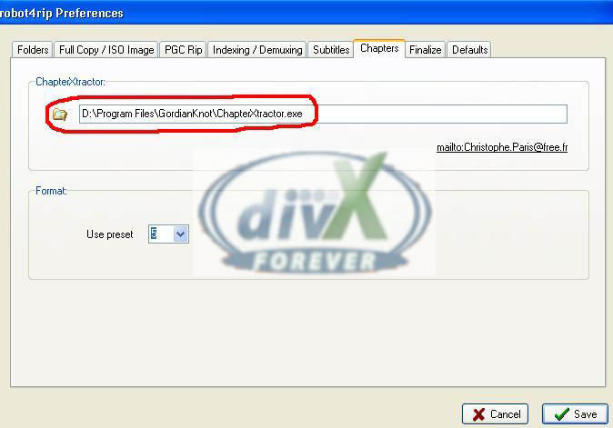

ChapterXTracker.exe’nin yolunu resimdeki gibi düzeltelim. Bu özelliği bu rehberde kullanmayacağız.

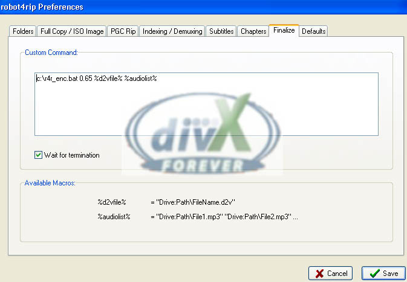

Finalize özelliğini de kullanmayacağız.

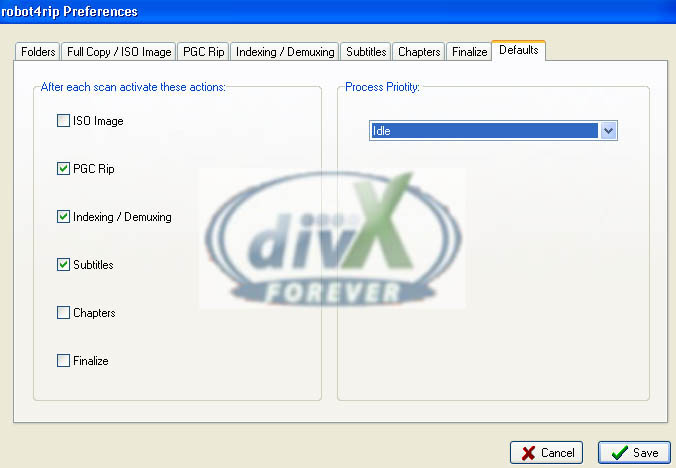

Son olarak Defaults sekmesinde, DVD’den veya HDD’den yapılan her dosya taraması sonrası varsayılan olarak açık veya kapalı olmasını istediğimiz özellikleri buradan belirliyoruz. Resimdeki gibi, PGC Rip, Indexing / Demuxing, Subtitles seçili olacak; ISO Image, Chapters ve Finalize seçili olmayacak.

Preferences ile ilgili ayarlar bu kadar. Save deyip çıkıyoruz. Tools > Audio Preferences’a giriyoruz. 

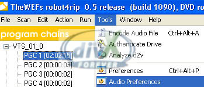

Audio Preferences’taki ayarlar, transcoding yapacaksak (AC3 > MP3 gibi) gerekli olacak. 

Transcoding en basit anlatımıyla daha önce sıkıştırılmış bir dosyanın decode edilip başka bir formatta yeniden sıkıştırılma işlemidir. Eğer lossy codec'lerle yapılırsa ilk sıkıştırmadaki kalite kaybının üstüne ikinci sıkıştırmada bir miktar daha kaliteden kaybedilir. Tercih edildiği koşullar olabilir. Bunlardan biri DVD'deki AC3 ses dosyasının MP3'e dönüştürülmesidir. 

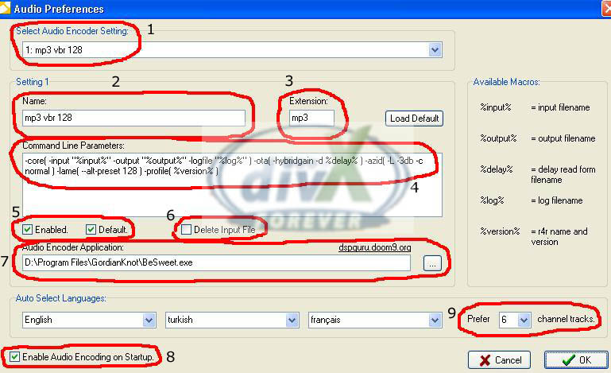

Resimde işaretli `9 ayar` görülebilir. Şimdi tek tek, bunların üzerinde duracağız. 

`1 numara` ile gösterilen ayar, DVD’deki orijinal ses dosyasını hangi formata dönüştüreceğimizi seçeceğimiz ayar. Aşağıdakiler formatlar yüklü geliyor:

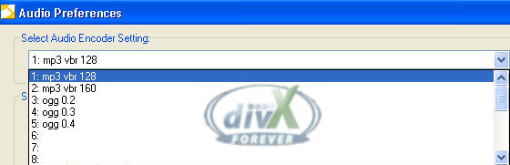

Bu formatlara ilave yapmak istersek önceki resimde 4 numara ile gösterdiğim yerdeki script ile oynamamız gerekecek. Örneğin mp3 128kbps vbr için script burada mevcut: 

-core( -input "%input%" -output "%output%" -logfile "%log%" ) -ota( -hybridgain -d %delay% ) -azid( -L -3db -c normal ) -lame( --alt-preset 128 ) -profile( %version% )

Şimdi buraya, mp3 192kbps vbr ekleyelim. 

Bunun için yukarıdaki resimde ilk 5 numara dolu, 6 numarayı seçelim. Bir üst resimde 2, 3 ve 4 numaralı yerlerdeki değerlerin ve yazıların kaybolduğunu göreceksiniz. Yeni ekleyeceğimiz format için 2 numaralı yere bir isim girelim: mp3 vbr 192. 3 numaralı yere extension olarak mp3 yazalım. Ses formatını, yaratacağımız 4 numaralı script kısmına ya yaratacağımız ses formatının script’ini öğrenip gireceğiz ya da mp3 192kbps için az yukarıya italik olarak kopyaladığım script’teki 128 değerini 192 yapacağız. Bundan sonra, transcoding işleminde bu formatı kullanmak için;

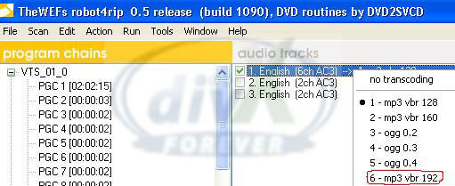

Yukarıdaki gibi ana ekranda, transcode etmek istediğimiz ses dosyasına sağ tıklayıp listeden çevireceğimiz formatı seçeceğiz.

Tekrardan yukarıda 9 tane numara koyduğum resme dönersek;
1, 2, 3 ve 4 numaraları anlattım. 5 numara ile transcode edeceğimiz orijinal dosyayı dönüştürme işlemi sonrası sildirebiliriz. Bence boş kalmasında fayda var. Gerekirse manuel olarak silmek daha fonksiyonel olacak.

7 numaralı ayarda besweet.exe’nin yerinin doğru gösterildiğinden emin oluyoruz. 8 numara seçili olacak. 9 numaralı yerde ise transcode işlemi öncesi, dönüştürme için seçilecek orijinal dosyanın 6 kanallısı ve 2 kanallısı 2 ayrı dosya olarak bir arada mevcut olabilir. Dönüştürmede, orijinal dosya olarak kaç kanallı sese sahip dosyayı tercih edeceğimizi belirliyoruz. 

Yukarıdaki ayarlardan sonra ok deyip robot4rip’in ana ekranına dönüyoruz. Şimdiye kadar ki ayarlar, genelde bir kez, robot4rip’in ilk kurulumunda yapılır. Ardından gerekmedikçe bu ayarlara dönmemize gerek yok.

Şimdi Robot4rip’i, Gordian Knot’ta yapacağımız encoding işlemi öncesi gerekli malzemeleri hazırlaması için kullanmaya başlayabiliriz.

Bu malzemeler nelerdir: 

- DVD’deki vob dosyaları
- ifo dosyasını aldıktan sonra oluşturulacak proje dosyaları: 
	- .d2v dosyası
	- ses dosyası (gerekirse transcode edilmiş ses dosyası ile birlikte)
	- vobsub altyazı dosyaları.

DVD’yi DVD-ROM’a takıyoruz.

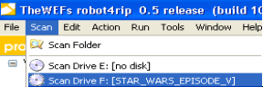

Yukarıdaki tarama ile DVD’yi gösteriyoruz. (Eğer DVD dosyaları HDD’de bulunuyorsa scan komutundan scan folder diyerek buradan HDD’deki dosyaları göstermemiz yeterli)

DVD’yi gösterdikten sonra robot4rip DVD içeriğini aşağıdaki şekilde görüntüleyecek.

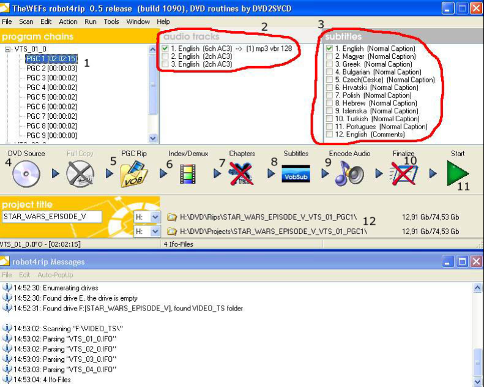

`1 numaralı` ayar otomatik yapılıyor. `2 numaralı ayar`da DVD’den almak istediğimiz ses dosyalarının yanındaki kutucuklara işaret koyuyoruz. `3 numara`da oluşturulacak VobSub dosyasında bulunmasını istediğiniz altyazı dillerini seçiyorsunuz. (Kendi rip’lerimde hepsini seçiyorum.) 4-5-6-7-8-9-10 ve 11 numaralı ayarlar birer butondur. Bunlara basıp o özelliği açabilir veya kapatabilirsiniz. Bunların ayarlarını, hangisinin varsayılan olarak açık olup olmayacağını az önce Preferences’ta Defaults sekmesi altında yapmıştık. Sırayla, `4 numara` kaynağın DVD olduğunu gösteriyor, `5 numara` açık olacak, `6 numara` ile robot4rip işleme başlayıp DVDDecrypter ile DVD’yi HDD’ye kaydettikten sonra DVD2AVI ile d2v dosyası yaratılacak ve DVD’deki sesler alınacak. `7 numara` chapters, bu özellik kapalı olacak. Vobsub’ı çalıştırıp altyazıları oluşturması için `8 numara` açık olacak. Eğer DVD’deki ses dosyalarından birini transcode edeceksek `9 numara` açık olacak ama mesela DVD’deki AC3 5+1 sesi kullanacaksak `9 numara`yı üzerine bir kez tıklayarak kapatın. DVD’deki ses dosyalarını AC3 5+1 dahil, 6 numara, DGIndex’i çalıştırıp demux edecek. `10 numarada`ki finalize kapalı olacak. `12 numarada`ki yolları ve özellikle HDD’nizdeki boş yer miktarını kontrol edin. 5 ile 10 GB arası bir yer gerekli olacak. Nihayetinde 11 numaradaki Start butonuna basarak robot4rip’i çalıştıralım.

İşlem başladıktan sonra bilgisayarın özelliklerine bağlı olarak sistemi biraz yavaşlatabilir. Bundan sonra otomatik olarak DVDDecrypter, DGIndex, VobSub ve 9 numaradaki encode audio’yu seçtiyseniz besweet işlem yapacaklar. 

İşlem tamamlandığında yapılan rip ile ilgili iki klasör yaratılmış olacak. İçlerine baktığımızda şunları göreceğiz:

1. **rips klasörü**

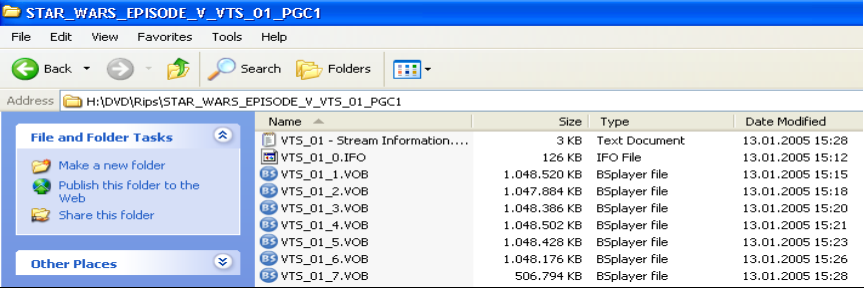

2. **projects klasörü**

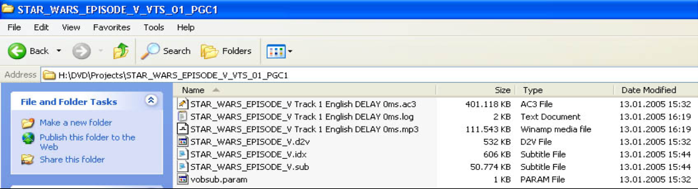

**Encoding öncesi malzememiz hazır.**

Robot4rip ile d2v dosyamızı analiz ediyoruz:

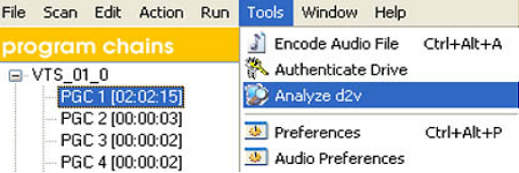

Proje klasörümüzün içindeki .d2v dosyasını gösterelim.

Analiz sonrası log’da, aşağıdaki türde bir mesaj belirecek. Burada önemli olan NTSC olup olmadığı ve filmin FPS’sini öğrenmemizdir.

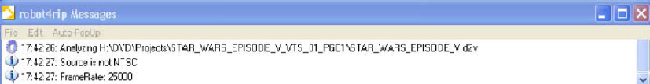

Robot4Rip’i artık kapatabiliriz.

---

Gordian Knot’u çalıştırıyoruz.

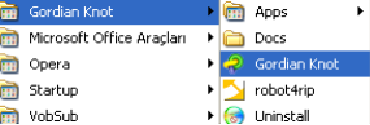
 
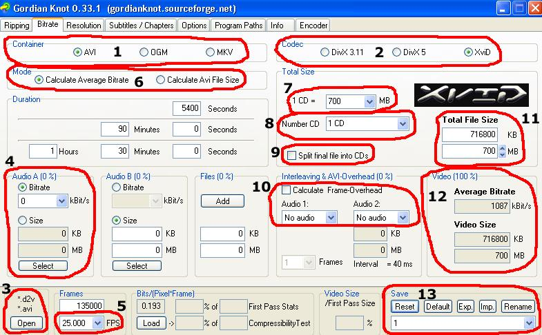

Gordian Knot’u ilk çalıştırdığımızda, Gordian Knot resimdeki bitrate sekmesi ile açılır. Gordian Knot’ta, üstte, sekiz sekmemiz mevcut: Ripping, Bitrate, Resolution, Subtitles/Chapters, Options, Program Paths, Info ve Encoder. 

Robot4rip ile hazırladığımız dosyaları istersek manuel olarak ripping ve Subtitles/Chapters sekmelerinden de hazırlayabiliriz. Bunun için Ripping sekmesini kullanarak, Rip the Vobs kısmından DVDDecrypter ile DVD’deki dosyaları HDD’ye aktarabilir, Prepare the Vob kısmından DGIndex ile d2v dosyası yaratabilir ve DVD’deki Audio’ları alabiliriz. Subtitles/Chapters kısmından Configure butonuna tıklayarak VobSub oluşturabiliriz. (VobSub dosyalarını ayrıca oluşturmakla ilgili bir kaynak forumda bulunmaktadır) Ancak bu işlemlerin tamamının robot4rip ile otomatik nasıl yapılacağını yukarıda anlattım.

Bitrate sekmesinden başlayalım.

`1 numara`lı ayardan encode işlemi sonucu hazırladığımız dosyanın hangi çıktı formatında olacağını belirliyoruz. `2 numara`lı ayardan kullanmak istediğimiz codec’i seçeceğiz. Yukarıdaki resimde seçilmiş olmasa da bu rip çalışmamızda XviD codec’ini kullanacağım. `3 numara`lı ayara tıklıyoruz ve robot4rip ile yarattığımız projects klasörünün içindeki .d2v dosyasını gösterip açıyoruz.

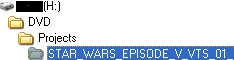
 
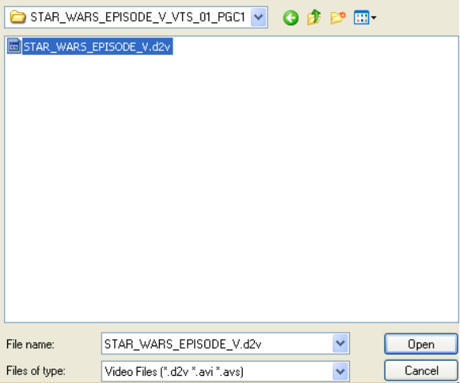

.d2v dosyamızı açtıktan sonra yeni bir pencere açılacak. İlk defa kullananlar, açılan yeni pencerede...

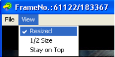

Resized'ı seçili değilse seçili hale getirmeliler.
s
Gordian Knot > Bitrate sekmesine ve iki yukarıdaki resme geri dönersek, 1, 2 ve 3 numaralı ayarları anlattım;

`4 numara`lı ayardan select butonuna basarak ses dosyasını seçeceğiz. Ses dosyası isterseniz DGIndex ile DVD’den aldığımız orijinal ses dosyası olabilir, isterseniz robot4rip ile Besweet’e transcode ettirdiğimiz ses dosyası olur. Ses dosyamızı seçtikten sonra, `5 numara`lı ayara sonra döneceğiz, `6 numara`lı ayarda `Calculate Average Bitrate` seçili olacak. `7 numara`lı ayarda `1 CD = 700 MB` yazması idealdir. 7 numaralı ayardan avi dosyamızı kaç CD yapacağımızı seçebiliriz. Buradan seçeceğiniz CD sayısını doğrudan `8 numara`daki şıktan seçeceğimiz CD sayısı ile çarpıp `11 numara` ile gösterdiğim yere ekleyecektir. İsterseniz manuel olarak `11 numara`dan, yapacağımız avi’nin kaç MB tutacağını girebiliriz. Burada benim kullandığım yöntem, eğer 2 CD ve üstünde yapacaksam; 7 numaralı yerde 1 CD = 700 MB yazılı iken, 8 numaralı ayardan 2 CD veya 3 CD’yi seçmek ve 11 numaralı yerdeki Total File Size’ı yapacağım CD başına 3 MB eksik göstermek. Örneğin, 2 CD = 1394 MB, 3 CD = 2091 MB, 4 CD= 2788 MB gibi. Bunun nedeni encoding sırasında ve sonradan sesi ekledikten sonra Gordian Knot’un hazırladığı avi’nin kapasitesinin burada girdiğimiz değerden biraz yüksek çıkması. 

Yapacağımız avi’nin boyutunu da ayarladıktan sonra `9 numara`daki kutuyu işaretlersek encode bittiği zaman Gordian Knot hazır avi dosyasını otomatik olarak CD kapasitesinde dosyalara böler. Ancak benim anlatmakta olduğum yöntemde filmin sesini, Gordian Knot encoding işlemini bitirdikten sonra ekleyeceğiz. Bunu seçersek, ses eklenmemiş filmi bölecek ki bu hata olur. Ayrıca kendi yönteminizle sesi Gordian Knot ile eklediğinizi düşünürsek böldüğü yerler, filmde aksiyonun bol olduğu bir ana veya bir diyaloğun ortasına gelebilir. Gene de, sonradan dosyayı kendimiz bölerken aynı sorunla karşılaşmamız muhtemel ama key framle’lerin azlığı negatif bir etken olsa da gene de birkaç ayrı yerden bölme şansımız olacak. `9 numara`daki kutucuğu boş bırakıyoruz. `10 numara`daki ayarı, aynı resimde olduğu gibi yapıyoruz. `12 numara`da, bir ayar yapmamız gerekmiyor. .d2v dosyasını açtıktan, sesi ekledikten ve dosya ebatımızı seçtikten sonra yapılacak rip’in video bitrate’inin kbps değeri ve video dosyasının kaç MB tutacağını buradan görebiliriz. Anlatmadığım 5 ve 13 numaralı ayarlar kaldı. 5 numaralı ayar için önceden eklediğim resmi tekrardan ekliyorum.

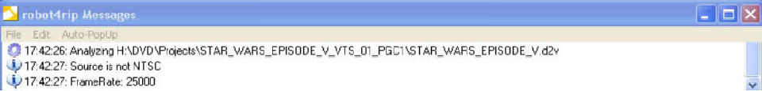

.d2v dosyasını robot4rip’e analiz ettirdiğimizde fps’si 25 çıkmış. Buna göre `Gordian Knot > Bitrate > 5 numara`lı ayarda da de FPS 25 olmalıdır. Bu değer 23,976 veya başka bir değer çıksaydı, bitrate sekmesinde 5 numaradaki FPS değerini çıkan değer yapmamız gerekirdi.

Son olarak, bitrate sekmesinde `13 numara`lı ayar, ilk defa Gordian Knot’u kullanırken pasif olacaktır. Ardından, ilk rip’ten sonra buradaki değeri reset’leyebilir, yeniden adlandırabiliriz (rename). Buradan, yaptığınız tüm Gordian Knot ayarlarını profil oluşturacak şekilde saklayabilirsiniz. Benim kullandığım bir özellik değil ama kullananılabilir. Benim yaptığım, her rip öncesi rename yaptıktan sonra reset edip bitrate ayarlarına öyle başlamak oluyor.

Bitrate sekmesini tamamladık. Referans olması için bitrate sekmesi tamamlanmış kendi ayarlarımı aşağıya ekliyorum:

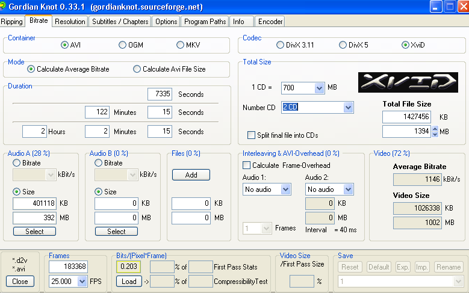

Gordian Knot > Resolution sekmesine geçelim.

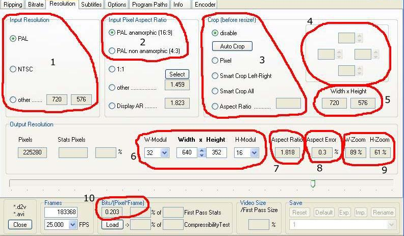

to be continued...