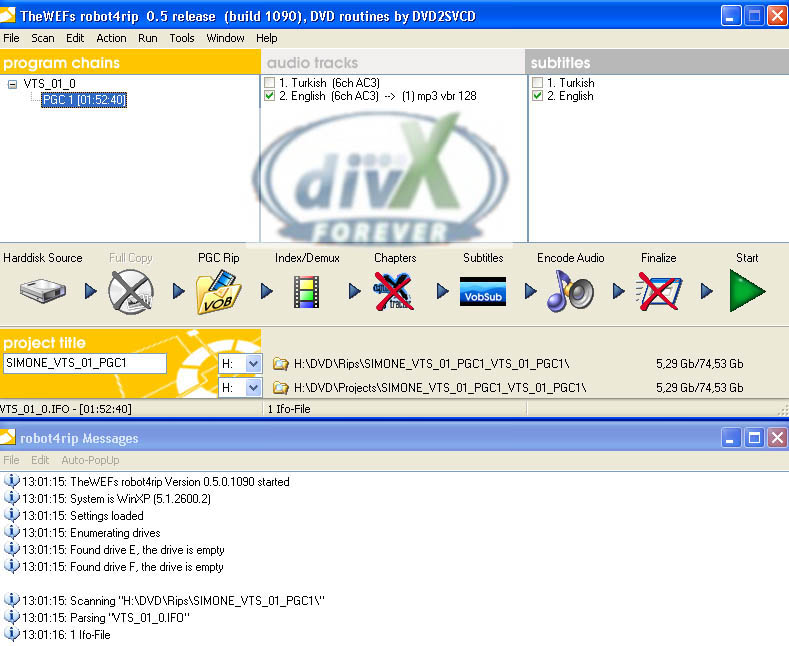

# DVD’DEN DIVX YAPIMI (ADIM ADIM)

## GEREKLİ PROGRAMLAR VE LİNKLERİ

1. [GordianKnot Rip Pack v.0.33.1](http://prdownloads.sourceforge.net/gordianknot/GordianKnot.RipPack.0.33.1.Setup.exe?download )
2. [Gordian Knot Codec Pack 1.9](http://prdownloads.sourceforge.net/gordianknot/Gordian.Knot.Codec.Pack.1.9.Setup.exe?download)

**Gordian Knot Rip Pack içindeki programlar:**

- **Gordian Knot**
	- DVDDecrypter
	- DGIndex
	- VirtualDubMod
	- Nandub
	- robot4rip
	- BeSweet
	- vStrip

**Adım adım izleyeceğimiz yol:**

1. robot4rip’i açıp tüm ayarlarını yapacağız. Ardından seçili ayarlarla çalıştırıp DVD’den DivX’e Encoding için gerekli malzemeyi oluşturacağız.
2. Gordian Knot arayüzü ile gerekli ayarlamaları yapacağız.

---

Rip paketini kurduktan sonra robot4rip’i açalım.

