# DVD’DEN DIVX YAPIMI (ADIM ADIM)

## GEREKLİ PROGRAMLAR VE LİNKLERİ

1. [GordianKnot Rip Pack v.0.33.1](http://prdownloads.sourceforge.net/gordianknot/GordianKnot.RipPack.0.33.1.Setup.exe?download )
2. [Gordian Knot Codec Pack 1.9](http://prdownloads.sourceforge.net/gordianknot/Gordian.Knot.Codec.Pack.1.9.Setup.exe?download)

**Gordian Knot Rip Pack içindeki programlar:**

- **Gordian Knot**
	- DVDDecrypter
	- DGIndex
	- VirtualDubMod
	- Nandub
	- robot4rip
	- BeSweet
	- vStrip

**Adım adım izleyeceğimiz yol:**

1. robot4rip’i açıp tüm ayarlarını yapacağız. Ardından seçili ayarlarla robotu çalıştırıp DVD’den DivX’e Encoding için gerekli ön-malzemeyi oluşturacağız.
2. Gordian Knot arayüzü ile gerekli ayarları yapacağız.

---

Rip paketini kurduktan sonra robot4rip’i açalım.

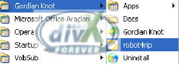

Aşağıdaki şekilde açılacak.

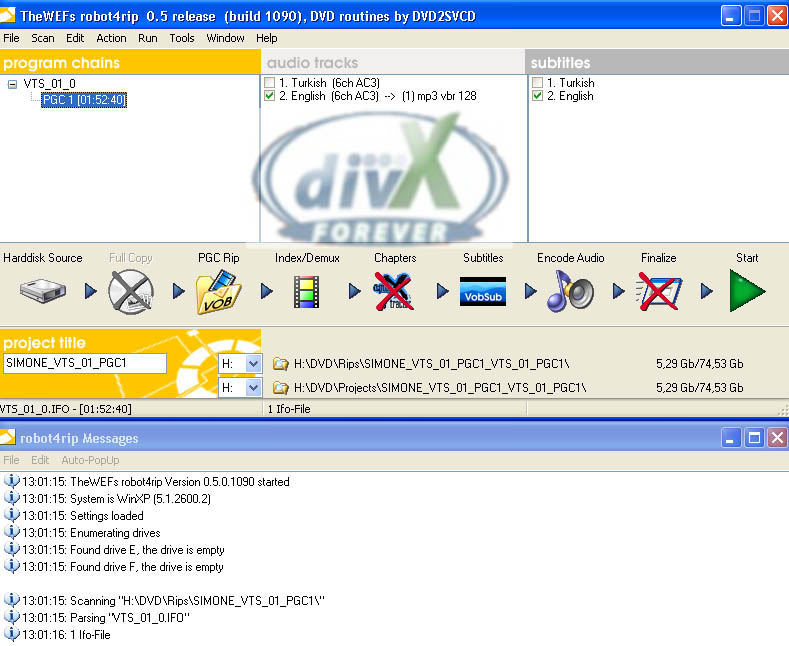

robot4rip'in ana penceresi yukarıdaki gibi. (Programdaki yazılı bilgiler benim son çalışmamdan kalanlar)

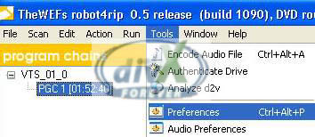

İlk kullanımda ayarları yapmamız gerekiyor. Bunun için `Tools > Preferences` yolunu izleyeceğiz.

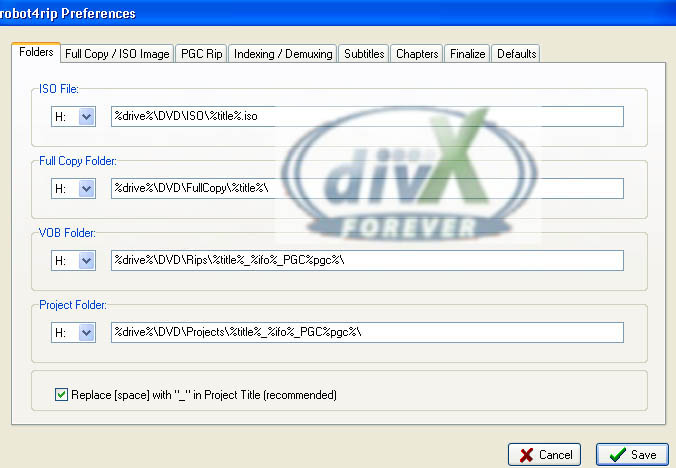

Preferences ekranı 8 sekmeden oluşuyor. Gordian Knot Rip Pack `v.0.33’teki bir bug’dan dolayı` robot4rip ile kullanacağım tüm entegre programların yolları hatalı gösterilmiş. Adım adım sekmeleri ayarlarken hatalı yolları da (path) kesinlikle düzeltmeliyiz.

Sırasıyla başlayalım. Soldan birinci sekme, `Folders` sekmesinde yaratılacak `ISO dosyası`, `Full Copy` dosyası, `Vob`’ların konulacağı klasör ve proje klasörünün yollarını gösterelim. Burada, kendi makinamda h: sürücüsünün root’unu kök klasör olarak atıyorum. Buradaki klasör atamaları programın default olarak ileride kullandığı klasörler olup sonradan aynı yerden istenildikleri gibi değiştirilmeleri mümkün.

Yukarıdaki resimdeki gibi `Replace [space] with “_” in Project Title (recommended)` seçili olacak.

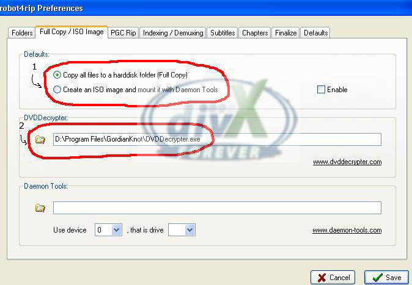

`Full Copy / ISO Image` sekmesinde, **1** numara ile işaretlenen ayarda DVD’deki dosyaları harddiske `tam kopya` mı alacağımızı yoksa `Daemon Tools` ile `ISO image`’ini mi yapacağımızı seçiyoruz. Resimdeki gösterildiği gibi `Copy all files to a harddisk folder (Full Copy)` seçili olacak. **2 numara** ile işaretlenen ayarda, DVD dosyalarını DVD’den HDD’ye çıkaracak `DVDDecrypter.exe` programının diskteki yolunu doğru gösterelim. Bunun için adresin solundaki küçük klasör ikonuna tıklamamız yeterli. Altındaki `Daemon Tool` ayarlarını ellemiyoruz.

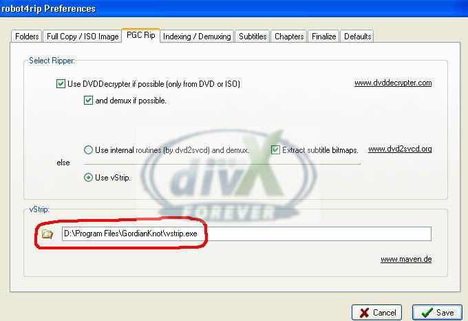

PGC Rip sekmesinde ayarlar yukarıdaki gibi olacak. Vstrip’in yol ifadesinin doğru olduğunu kontrol edelim.

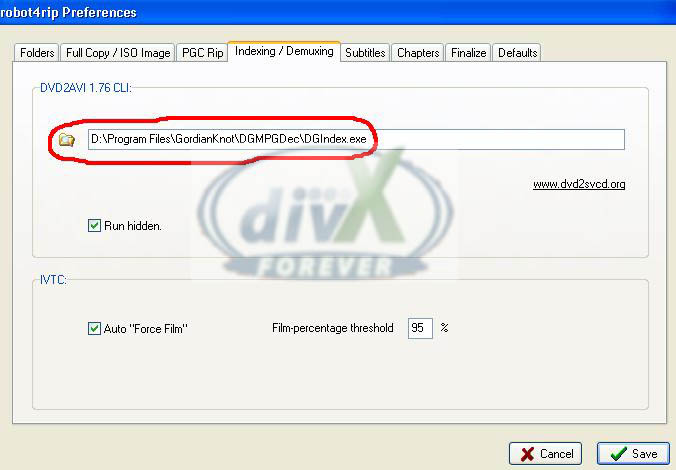

Indexing/Demuxing sekmesinde DVD2AVI’nin yolunu gösterirken Gordian Knot 0.33 versiyonu için yeni geliştirilmiş DGIndex.exe programının yolunu göstereceğiz. Diğer ayarlar yukarıdaki gibi olacak.

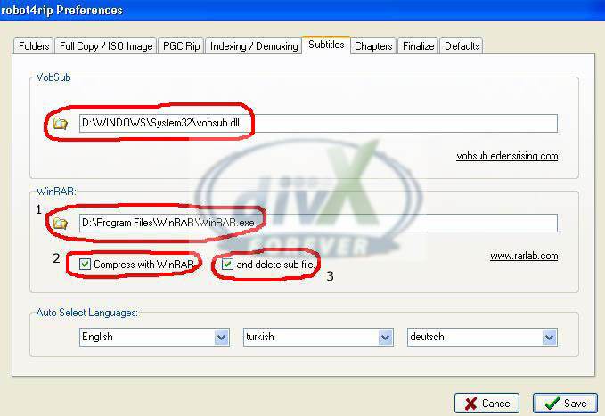

Subtitles sekmesinde `vobsub.dll` dosyasının yolunu düzeltiyoruz. VobSub dosyaları robot4rip ile otomatik olarak yaratıldıktan sonra istersek gene robot4rip ile; yaratılan bu iki VobSub dosyasını (`.sub` ve `.idx` dosyaları) resimde `1 numara` ile gösterilen kısma bilgisayarımızdaki `winrar.exe`’nin yolunu göstererek otomatik olarak rar’latabilir, `2 numaralı` kutuyu seçerek sıkıştırtabilir ve `3 numaralı` kutuyu seçerek sıkıştırmadan önceki VobSub dosyalarını sildirtebiliriz.

`Auto Select Language` kısmında DVD’de bulunan altyazılardan hangi dillerde olanlarını otomatik olarak seçmesini istediğimizi robot4rip'e gösterebiliriz. Kendi rip’lerimde DVD’deki tüm altyazıları aldığım ve ne yapacağıma ondan sonra karar verdiğim için bu şıkkın benim için pek önemi yok.

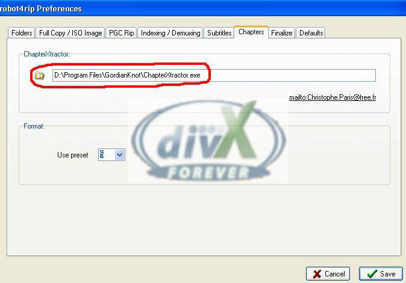

ChapterXTracker.exe’nin yolunu resimdeki gibi düzeltelim. Bu özelliği bu rehberde kullanmayacağız.

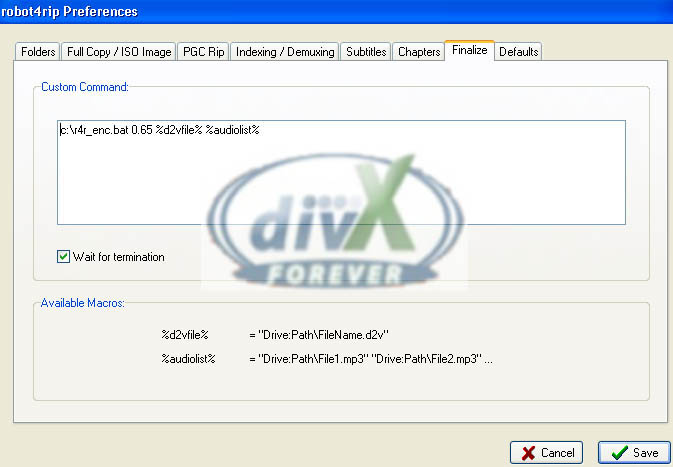

Finalize özelliğini de kullanmayacağız.

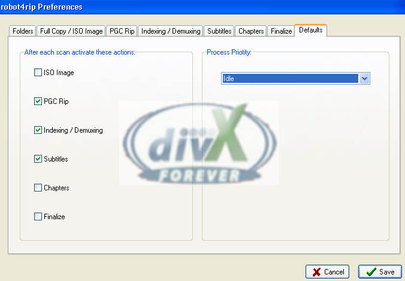

Son olarak Defaults sekmesinde, DVD’den veya HDD’den yapılan her dosya taraması sonrası varsayılan olarak açık veya kapalı olmasını istediğimiz özellikleri buradan belirliyoruz. Resimdeki gibi, PGC Rip, Indexing / Demuxing, Subtitles seçili olacak; ISO Image, Chapters ve Finalize seçili olmayacak.

Preferences ile ilgili ayarlar bu kadar. Save deyip çıkıyoruz. Tools > Audio Preferences’a giriyoruz. 

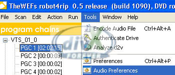

Audio Preferences’taki ayarlar, transcoding yapacaksak (AC3 > MP3 gibi) gerekli olacak. 

Transcoding en basit anlatımıyla daha önce sıkıştırılmış bir dosyanın decode edilip başka bir formatta yeniden sıkıştırılma işlemidir. Eğer lossy codec'lerle yapılırsa ilk sıkıştırmadaki kalite kaybının üstüne ikinci sıkıştırmada bir miktar daha kaliteden kaybedilir. Tercih edildiği koşullar olabilir. Bunlardan biri DVD'deki AC3 ses dosyasının MP3'e dönüştürülmesidir. 

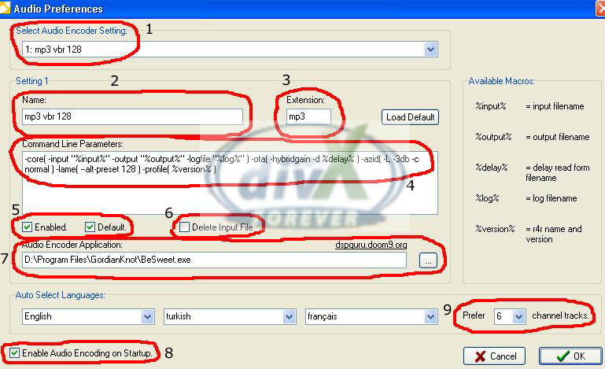

Resimde işaretli `9 ayar` görülebilir. Şimdi tek tek, bunların üzerinde duracağız. 

`1 numara` ile gösterilen ayar, DVD’deki orijinal ses dosyasını hangi formata dönüştüreceğimizi seçeceğimiz ayar. Aşağıdakiler formatlar yüklü geliyor:

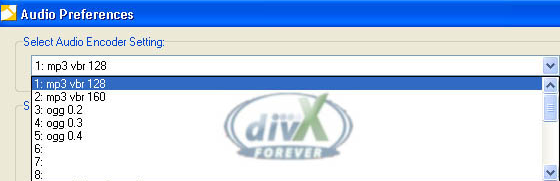

Bu formatlara ilave yapmak istersek önceki resimde 4 numara ile gösterdiğim yerdeki script ile oynamamız gerekecek. Örneğin mp3 128kbps vbr için script burada mevcut: 

-core( -input "%input%" -output "%output%" -logfile "%log%" ) -ota( -hybridgain -d %delay% ) -azid( -L -3db -c normal ) -lame( --alt-preset 128 ) -profile( %version% )

Şimdi buraya, mp3 192kbps vbr ekleyelim. 

Bunun için yukarıdaki resimde ilk 5 numara dolu, 6 numarayı seçelim. Bir üst resimde 2, 3 ve 4 numaralı yerlerdeki değerlerin ve yazıların kaybolduğunu göreceksiniz. Yeni ekleyeceğimiz format için 2 numaralı yere bir isim girelim: mp3 vbr 192. 3 numaralı yere extension olarak mp3 yazalım. Ses formatını, yaratacağımız 4 numaralı script kısmına ya yaratacağımız ses formatının script’ini öğrenip gireceğiz ya da mp3 192kbps için az yukarıya italik olarak kopyaladığım script’teki 128 değerini 192 yapacağız. Bundan sonra, transcoding işleminde bu formatı kullanmak için;

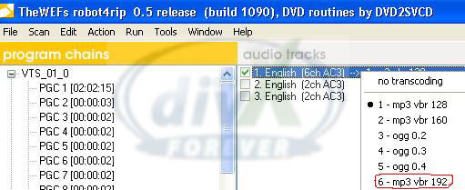

Yukarıdaki gibi ana ekranda, transcode etmek istediğimiz ses dosyasına sağ tıklayıp listeden çevireceğimiz formatı seçeceğiz.

Tekrardan yukarıda 9 tane numara koyduğum resme dönersek;
1, 2, 3 ve 4 numaraları anlattım. 5 numara ile transcode edeceğimiz orijinal dosyayı dönüştürme işlemi sonrası sildirebiliriz. Bence boş kalmasında fayda var. Gerekirse manuel olarak silmek daha fonksiyonel olacak.

7 numaralı ayarda besweet.exe’nin yerinin doğru gösterildiğinden emin oluyoruz. 8 numara seçili olacak. 9 numaralı yerde ise transcode işlemi öncesi, dönüştürme için seçilecek orijinal dosyanın 6 kanallısı ve 2 kanallısı 2 ayrı dosya olarak bir arada mevcut olabilir. Dönüştürmede, orijinal dosya olarak kaç kanallı sese sahip dosyayı tercih edeceğimizi belirliyoruz. 

Yukarıdaki ayarlardan sonra ok deyip robot4rip’in ana ekranına dönüyoruz. Şimdiye kadar ki ayarlar, genelde bir kez, robot4rip’in ilk kurulumunda yapılır. Ardından gerekmedikçe bu ayarlara dönmemize gerek yok.

Şimdi Robot4rip’i, Gordian Knot’ta yapacağımız encoding işlemi öncesi gerekli malzemeleri hazırlaması için kullanmaya başlayabiliriz.

Bu malzemeler nelerdir: 

- DVD’deki vob dosyaları
- ifo dosyasını aldıktan sonra oluşturulacak proje dosyaları: 
	- .d2v dosyası
	- ses dosyası (gerekirse transcode edilmiş ses dosyası ile birlikte)
	- vobsub altyazı dosyaları.

DVD’yi DVD-ROM’a takıyoruz.

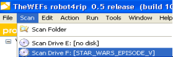

Yukarıdaki tarama ile DVD’yi gösteriyoruz. (Eğer DVD dosyaları HDD’de bulunuyorsa scan komutundan scan folder diyerek buradan HDD’deki dosyaları göstermemiz yeterli)

DVD’yi gösterdikten sonra robot4rip DVD içeriğini aşağıdaki şekilde görüntüleyecek.

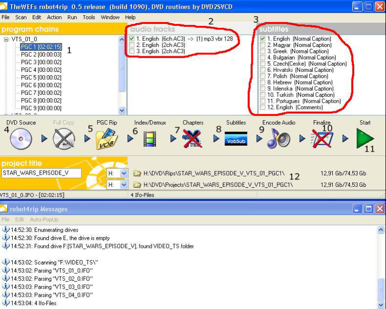

`1 numaralı` ayar otomatik yapılıyor. `2 numaralı ayar`da DVD’den almak istediğimiz ses dosyalarının yanındaki kutucuklara işaret koyuyoruz. `3 numara`da oluşturulacak VobSub dosyasında bulunmasını istediğiniz altyazı dillerini seçiyorsunuz. (Kendi rip’lerimde hepsini seçiyorum.) 4-5-6-7-8-9-10 ve 11 numaralı ayarlar birer butondur. Bunlara basıp o özelliği açabilir veya kapatabilirsiniz. Bunların ayarlarını, hangisinin varsayılan olarak açık olup olmayacağını az önce Preferences’ta Defaults sekmesi altında yapmıştık. Sırayla, `4 numara` kaynağın DVD olduğunu gösteriyor, `5 numara` açık olacak, `6 numara` ile robot4rip işleme başlayıp DVDDecrypter ile DVD’yi HDD’ye kaydettikten sonra DVD2AVI ile d2v dosyası yaratılacak ve DVD’deki sesler alınacak. `7 numara` chapters, bu özellik kapalı olacak. Vobsub’ı çalıştırıp altyazıları oluşturması için `8 numara` açık olacak. Eğer DVD’deki ses dosyalarından birini transcode edeceksek `9 numara` açık olacak ama mesela DVD’deki AC3 5+1 sesi kullanacaksak `9 numara`yı üzerine bir kez tıklayarak kapatın. DVD’deki ses dosyalarını AC3 5+1 dahil, 6 numara, DGIndex’i çalıştırıp demux edecek. `10 numarada`ki finalize kapalı olacak. `12 numarada`ki yolları ve özellikle HDD’nizdeki boş yer miktarını kontrol edin. 5 ile 10 GB arası bir yer gerekli olacak. Nihayetinde 11 numaradaki Start butonuna basarak robot4rip’i çalıştıralım.

İşlem başladıktan sonra bilgisayarın özelliklerine bağlı olarak sistemi biraz yavaşlatabilir. Bundan sonra otomatik olarak DVDDecrypter, DGIndex, VobSub ve 9 numaradaki encode audio’yu seçtiyseniz besweet işlem yapacaklar. 

İşlem tamamlandığında yapılan rip ile ilgili iki klasör yaratılmış olacak. İçlerine baktığımızda şunları göreceğiz:

1. **rips klasörü**

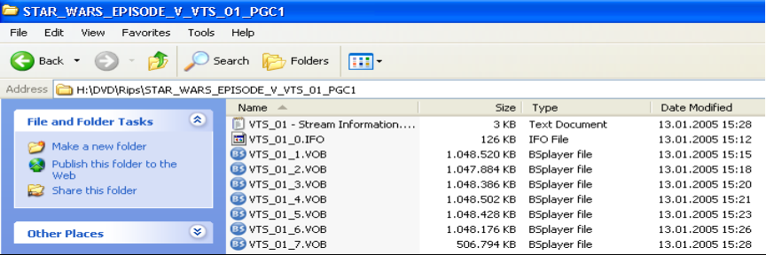

2. **projects klasörü**

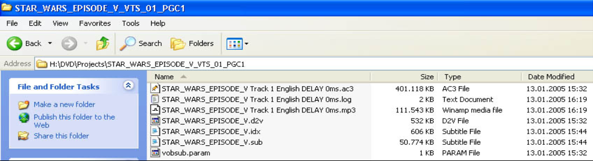

**Encoding öncesi malzememiz hazır.**

Robot4rip ile d2v dosyamızı analiz ediyoruz:

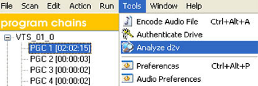

Proje klasörümüzün içindeki .d2v dosyasını gösterelim.

Analiz sonrası log’da, aşağıdaki türde bir mesaj belirecek. Burada önemli olan NTSC olup olmadığı ve filmin FPS’sini öğrenmemizdir.

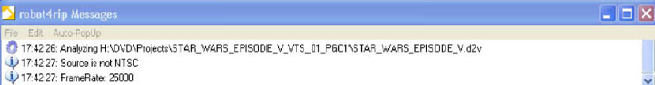

Robot4Rip’i artık kapatabiliriz.

---

Gordian Knot’u çalıştırıyoruz.

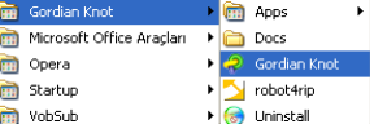
 
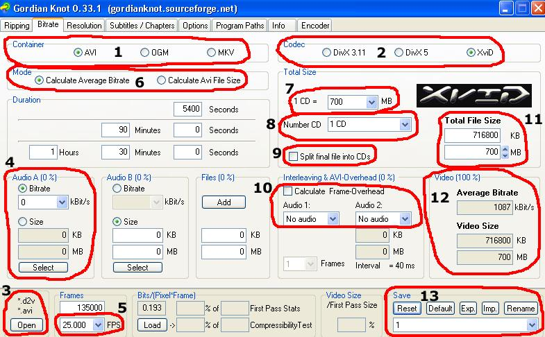

Gordian Knot’u ilk çalıştırdığımızda, Gordian Knot resimdeki bitrate sekmesi ile açılır. Gordian Knot’ta, üstte, sekiz sekmemiz mevcut: Ripping, Bitrate, Resolution, Subtitles/Chapters, Options, Program Paths, Info ve Encoder. 

Robot4rip ile hazırladığımız dosyaları istersek manuel olarak ripping ve Subtitles/Chapters sekmelerinden de hazırlayabiliriz. Bunun için Ripping sekmesini kullanarak, Rip the Vobs kısmından DVDDecrypter ile DVD’deki dosyaları HDD’ye aktarabilir, Prepare the Vob kısmından DGIndex ile d2v dosyası yaratabilir ve DVD’deki Audio’ları alabiliriz. Subtitles/Chapters kısmından Configure butonuna tıklayarak VobSub oluşturabiliriz. (VobSub dosyalarını ayrıca oluşturmakla ilgili bir kaynak forumda bulunmaktadır) Ancak bu işlemlerin tamamının robot4rip ile otomatik nasıl yapılacağını yukarıda anlattım.

Bitrate sekmesinden başlayalım.

`1 numara`lı ayardan encode işlemi sonucu hazırladığımız dosyanın hangi çıktı formatında olacağını belirliyoruz. `2 numara`lı ayardan kullanmak istediğimiz codec’i seçeceğiz. Yukarıdaki resimde seçilmiş olmasa da bu rip çalışmamızda XviD codec’ini kullanacağım. `3 numara`lı ayara tıklıyoruz ve robot4rip ile yarattığımız projects klasörünün içindeki .d2v dosyasını gösterip açıyoruz.

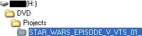
 
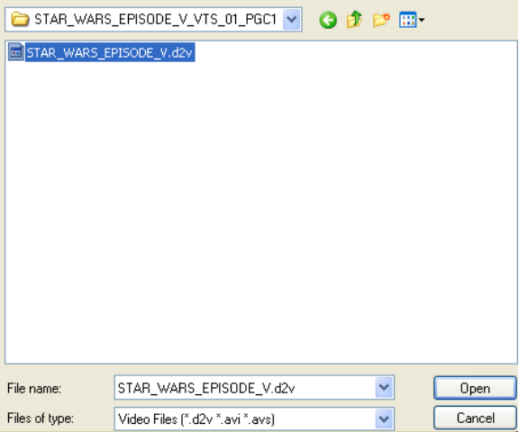

.d2v dosyamızı açtıktan sonra yeni bir pencere açılacak. İlk defa kullananlar, açılan yeni pencerede...

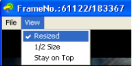

Resized'ı seçili değilse seçili hale getirmeliler.
s
Gordian Knot > Bitrate sekmesine ve iki yukarıdaki resme geri dönersek, 1, 2 ve 3 numaralı ayarları anlattım;

`4 numara`lı ayardan select butonuna basarak ses dosyasını seçeceğiz. Ses dosyası isterseniz DGIndex ile DVD’den aldığımız orijinal ses dosyası olabilir, isterseniz robot4rip ile Besweet’e transcode ettirdiğimiz ses dosyası olur. Ses dosyamızı seçtikten sonra, `5 numara`lı ayara sonra döneceğiz, `6 numara`lı ayarda `Calculate Average Bitrate` seçili olacak. `7 numara`lı ayarda `1 CD = 700 MB` yazması idealdir. 7 numaralı ayardan avi dosyamızı kaç CD yapacağımızı seçebiliriz. Buradan seçeceğiniz CD sayısını doğrudan `8 numara`daki şıktan seçeceğimiz CD sayısı ile çarpıp `11 numara` ile gösterdiğim yere ekleyecektir. İsterseniz manuel olarak `11 numara`dan, yapacağımız avi’nin kaç MB tutacağını girebiliriz. Burada benim kullandığım yöntem, eğer 2 CD ve üstünde yapacaksam; 7 numaralı yerde 1 CD = 700 MB yazılı iken, 8 numaralı ayardan 2 CD veya 3 CD’yi seçmek ve 11 numaralı yerdeki Total File Size’ı yapacağım CD başına 3 MB eksik göstermek. Örneğin, 2 CD = 1394 MB, 3 CD = 2091 MB, 4 CD= 2788 MB gibi. Bunun nedeni encoding sırasında ve sonradan sesi ekledikten sonra Gordian Knot’un hazırladığı avi’nin kapasitesinin burada girdiğimiz değerden biraz yüksek çıkması. 

Yapacağımız avi’nin boyutunu da ayarladıktan sonra `9 numara`daki kutuyu işaretlersek encode bittiği zaman Gordian Knot hazır avi dosyasını otomatik olarak CD kapasitesinde dosyalara böler. Ancak benim anlatmakta olduğum yöntemde filmin sesini, Gordian Knot encoding işlemini bitirdikten sonra ekleyeceğiz. Bunu seçersek, ses eklenmemiş filmi bölecek ki bu hata olur. Ayrıca kendi yönteminizle sesi Gordian Knot ile eklediğinizi düşünürsek böldüğü yerler, filmde aksiyonun bol olduğu bir ana veya bir diyaloğun ortasına gelebilir. Gene de, sonradan dosyayı kendimiz bölerken aynı sorunla karşılaşmamız muhtemel ama key framle’lerin azlığı negatif bir etken olsa da gene de birkaç ayrı yerden bölme şansımız olacak. `9 numara`daki kutucuğu boş bırakıyoruz. `10 numara`daki ayarı, aynı resimde olduğu gibi yapıyoruz. `12 numara`da, bir ayar yapmamız gerekmiyor. .d2v dosyasını açtıktan, sesi ekledikten ve dosya ebatımızı seçtikten sonra yapılacak rip’in video bitrate’inin kbps değeri ve video dosyasının kaç MB tutacağını buradan görebiliriz. Anlatmadığım 5 ve 13 numaralı ayarlar kaldı. 5 numaralı ayar için önceden eklediğim resmi tekrardan ekliyorum.

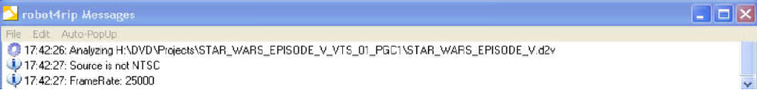

.d2v dosyasını robot4rip’e analiz ettirdiğimizde fps’si 25 çıkmış. Buna göre `Gordian Knot > Bitrate > 5 numara`lı ayarda da de FPS 25 olmalıdır. Bu değer 23,976 veya başka bir değer çıksaydı, bitrate sekmesinde 5 numaradaki FPS değerini çıkan değer yapmamız gerekirdi.

Son olarak, bitrate sekmesinde `13 numara`lı ayar, ilk defa Gordian Knot’u kullanırken pasif olacaktır. Ardından, ilk rip’ten sonra buradaki değeri reset’leyebilir, yeniden adlandırabiliriz (rename). Buradan, yaptığınız tüm Gordian Knot ayarlarını profil oluşturacak şekilde saklayabilirsiniz. Benim kullandığım bir özellik değil ama kullananılabilir. Benim yaptığım, her rip öncesi rename yaptıktan sonra reset edip bitrate ayarlarına öyle başlamak oluyor.

Bitrate sekmesini tamamladık. Referans olması için bitrate sekmesi tamamlanmış kendi ayarlarımı aşağıya ekliyorum:

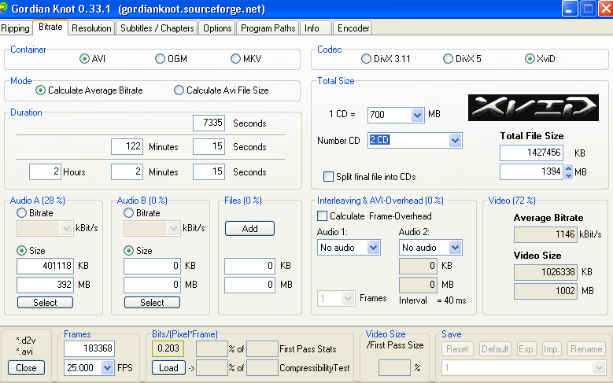

Gordian Knot > Resolution sekmesine geçelim.

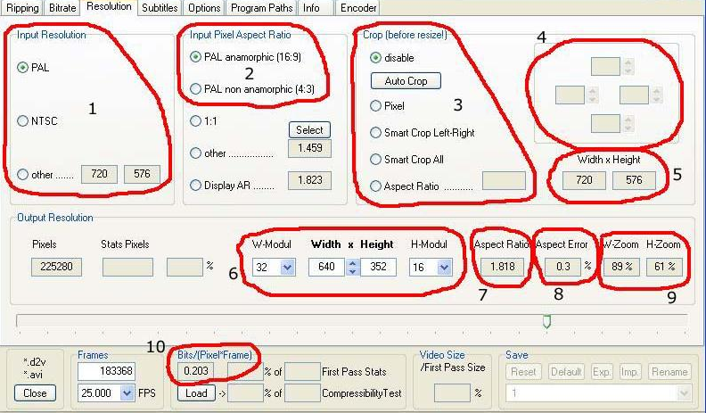

İşaretlenmiş 10 adet ayarımız var. Hemen başlayalım. 

`1 numaralı` ayarda, DVD’nin formatını seçiyoruz. Bunu, aynı zamanda robot4rip’te `Tools > Analyze d2v` komutunu çalıştırdıktan sonra filmin FPS’si ile birlikte `messages` kısmında görmüştük. Benim projemde `Source is not NTSC` mesajını vermişti. Dolayısıyla bende PAL olması gerektiğini öğrenmiştik. 

`2 numaralı` ayarda, rip’lemekte olduğumuz film Widescreen (Geniş Ekran – 16:9) mi, Fullscreen (Tam Ekran – 4:3) mi, buna göre seçimimizi yapmamız gerekiyor. Burada yapacağımız yanlış bir seçim filmin aspect ratio’sunun (görüntü oranı) bozuk olmasına neden olacak. DVD filmlerin kutusunun arkasında filmin “Tam Ekran” veya “Geniş Ekran” olduğu belirtilmiştir. Bunun dışında filmimizin görüntü oranını, DGIndex ile birinci vob dosyasını göstererek ve F5 ile preview yaparak DGIndex penceresinin sağında açılacak pencereden öğrenebiliriz. 

`3 numaralı` ayara geçersek, burada filmin etrafındaki siyah bantları temizleyeceğiz. Bunu tamamen deneme/yanılma ile manuel yapabileceğimiz gibi kendimizi geliştirdikçe siyah bantı makaslamak için kendimizce teknikler de geliştirebiliriz. Kendi kullandığım teknik şöyle: `Auto Crop`’a basalım, fazlalıkları temizlesin. Ardından `Smart Crop All`’u seçelim. `4 numara` ile gösterdiğim yerde yazan değerleri bir kenara not alalım. Auto Crop’un altındaki `Pixel` radyo butonunu seçelim ve elle, demin 4 numarada gözüken ama `Pixel`’i seçtikten sonra değişen değerleri girelim. Sonrasında aşağıdaki kurallara da uyacak şekilde manuel olarak değerleri değiştirebiliriz. 

Bu aşamada görüntüdeki siyah bantı makaslarken uymamız ve tutturmamız gereken kurallar ve ayarlar var. Bu kısım acemi ripper’ları en çok zorlayacak kısım olduğu için uyulması şart kural ve ayarları madde madde yazıyorum:

1. Pixel butonu seçiliyken, 4 numaradaki yukarı sol, sağ, üst ve alt crop değerlerini, yanlarındaki artır ve düşür butonlarını kullanarak görüntüde siyah bant kalmışsa temizleyelim, görüntünün içine fazla girilmişse değeri geri çekelim.
2. 4 numaradaki crop ayarını yaparken 5 numaradaki width ve height değerlerinin her ikisinin de **dörde bölünebilir** kalmasına dikkat edelim.
3. Crop ayarlarını yaparken 8 numaradaki Aspect Error’ün fazla yükselmemesine dikkat edelim. Kendi rip’lerimde aspect error’ü %0,3’ün üstüne çıkarmamaya dikkat ederim. Nadiren %0,4 olur.
4. 9 numaradaki değerlerin yazılı olduğu kutucukların kırmızı **olmamasına** dikkat edelim. Bu ikaz rengidir ve kullandığımız çözünürlüğün ekran ebatlarından taştığı anlamına gelir. 
5. 6 numaradaki çözünürlüğü değiştirmek, 8, 9 ve 10 numaradaki değerleri doğrudan etkileyecektir. Crop’lamanın mantığını ve kurallarını anladıktan sonra aşağıda 6 numaradaki değerlere değineceğim.

Yukarıdaki maddelere dikkat ederek crop işlemini yaparken değiştirdiğiniz ayarları eski haline getirmeniz çok kolay, biraz deneme yapın.

6 numaradaki width x height değeri yapacağımız avi’nin çözünürlüğüdür. Release standart’larına uygun olması için width değerini 512 ile 640 arasında tutmamız gerekir. Çözünürlüğü artırdıkça 10 numaradaki Bits (Pixel * Frame) değeri düşecektir. Bu değer çözünürlük değeri ile ters orantılıdır. 10 numaradaki değeri 0,200’ün altına düşürmemeye çalışmalıyız. Daha kaliteli bir rip’te minimum Bits (Pixel*Frame) değerini 0,220’ye yükseltebiliriz.

Resolution sekmesinin de sonuna geldik. Kendi ayarlarım aşağıdaki gibidir:

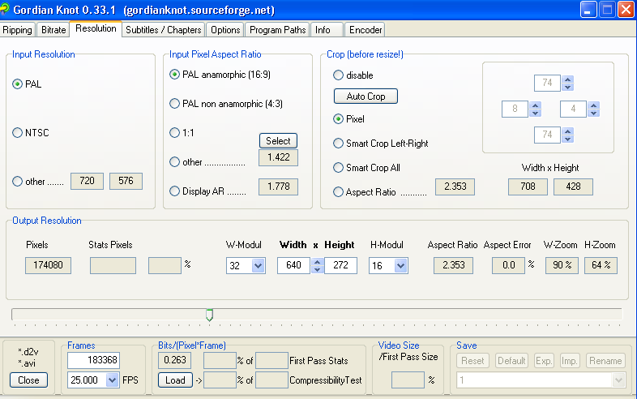

Gordian Knot’ta sekmelere devam edelim. Options sekmesine geçelim:

Options sekmesindeki ayarlar, codec ayarları ile ilgilidir. İlk sefer ayarlarız ve sonrasında gerekmedikçe ellemeyiz. Ekran görüntüsü aşağıdaki gibidir:

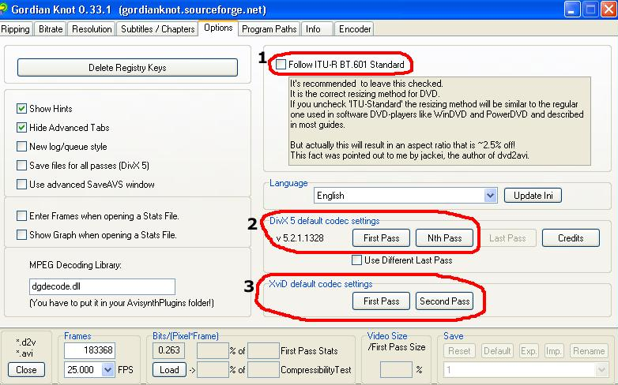

`1 numaradaki` **ITU-R BT.601 Standart**’ının seçili olmaması gerekiyor. Bu ayar seçili kalırsa filmin Aspect Ratio’sunu bozabilir.
`2 numarada` DivX Codec ayarları mevcut. Filmimizi XviD yapacağımız için `3 numaradaki` First Pass’a tıklayalım.

Codec ayarlarına başlamadan önce belirtmeliyim ki, çıkan her yeni codec versiyonu ile birlikte codec ayarlarının görünüşü değişmektedir. Codec konusu encoding işlemi ile doğrudan ilgili olsa da yeni versiyonlarının takibi ve açıklanması ayrı bir rehber ister. Bu nedenle codec ayarlarımızı bu rehberde **XviD XviD-1.0.3-20122004_Final_Release**’e göre yapacağız. 

XviD ayarlarını resimlerle anlatacağım. Aşağıda kendi kullandığım ayarlar mevcut. First Pass butonuna tıklayarak ayarları aynı şekilde seçelim:

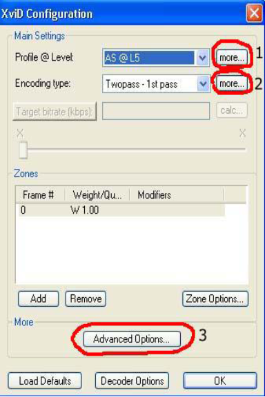

Yukarıdaki resimdeki “Profile” ve “Encoding Type” combobox'larında aynı şıkları seçtiğimizden emin olup `1 numara` ile işaretlenen butona tıklayalım.

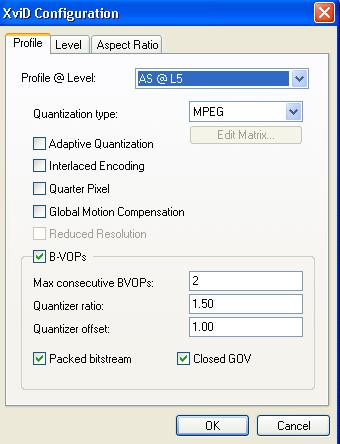

Kontrol edelim, `Quantization Type`, 1 CD yapılacak rip’lerde `H.263`, 1 CD’den fazla rip’lerde `MPEG` olacak. `Level` ve `Aspect Ratio` sekmeleri varsayılan ayarlarıyla kalsın. OK butonuna basıp çıkalım.

Bir üst resimdeki `2 numaralı` butona tıklayalım.

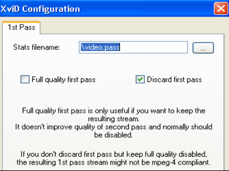

Ayarlarımızı yukarıdaki resimdeki ayarlarla kontrol edelim.

İki üst resimdeki `3 numaralı` butona tıklayalım.

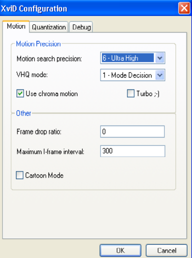

Ayarlarımız yukarıdaki resimdeki ayarlarla aynı mı, kontrol edelim. İsterseniz Turbo’yu seçebilirsiniz. First Pass ayarlarında Turbo kullanmıyorum.

Ok diyerek First Pass ayarlarından çıkalım ve `Godian Knot > Options` ekranından `XviD > Second Pass` ayarlarına girelim:

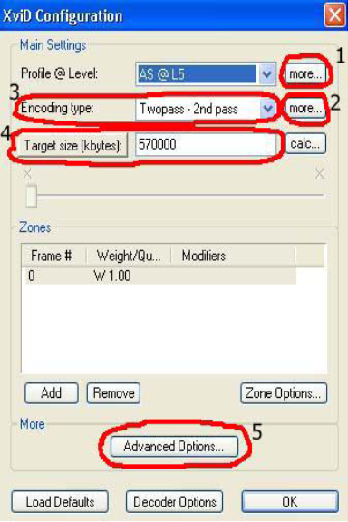

Second Pass penceresinde 5 işaretli yerimiz var. `1 numaradaki` ayarlar aynı az önce yukarıda yaptığımız First Pass’taki ayarlar ile aynı olacak. `2 numaradaki` ayarlar...

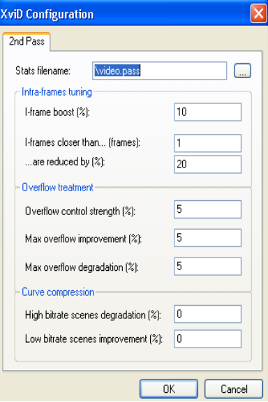

...resimdeki gibi olacak. `Stats Filename`’de dikkat edilmesi gereken önemli nokta, buradaki .pass (second pass) dosyasının yolu yukarıdaki first pass ayarlarında `Stats Filename`’de gösterilen .pass yolu ile aynı olacak. Ayarları yapıp ok deyip çıkalım.

Second Pass penceresine geri dönersek, `3 numaradaki` ayarı resimdeki gibi **Twopass – 2nd Pass** yapacağız. `4 numarada`ki Target Size'a ileride tekrar döneceğiz. Şimdilik karşısındaki 570000 değerinin bir önemi yok. Buna ileride tekrar değineceğiz. `5 numaradaki` Advanced Options penceresindeki tüm değerler First Pass’ta anlatıldığı gibi olacak.

Codec ayarlarını tamamladık. Gordian Knot ana penceresine döndükten sonra pencere başlığında (window title)  `FrameNo.` yazılı, açık diğer pencereye geçelim.

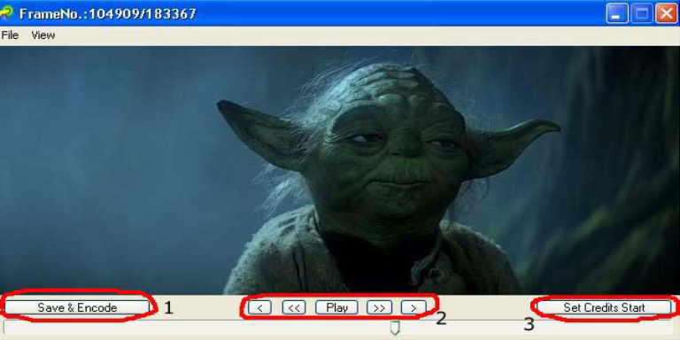

`1 numaralı` Save & Encode butonu ile devam etmeden önce `2 numaralı` butonlarla, filmin sonunda credit’lerin başladığı frame’i bulalım ve `Set Credits Start`’a basalım. Böylece, Credit kısmını daha düşük kalitede rip’lerken filmin geri kalanı için daha yüksek bitrate'imiz kalacak.

`1 numaraya` tıklayalım. Aşağıdaki pencere açılacak:

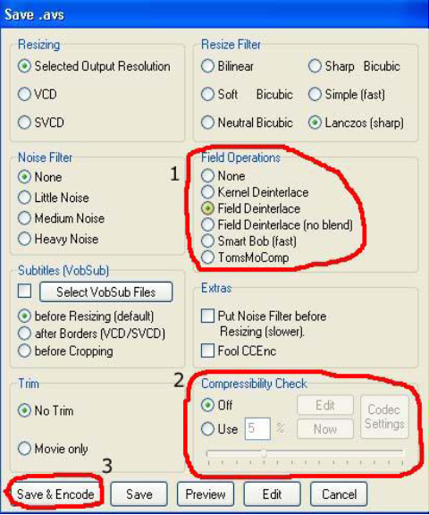

`1 numaralı` işaretli ayar hariç tüm ayarlar resimdeki gibi olacak. 1 numaradaki ayar, DVD progressive ise `None`, Interlaced ise `Field Deinterlace` olacak. Bunu anlamak için DGIndex ile vob dosyasını açıp F5 preview ile oynatırsanız Frame Type’da DVD’nin Progressive mi Interlace mi olduğunu öğrenebilirsiniz.

`2 numara` ile işaretlediğim yerden kalite kontrolü yapabilirsiniz. Use’u seçerek filmin yüzde kaçını encode edeceğini belirtirsiniz. Now ile test eder, sonucunda değerlerini verir.

1 numarayı ayarladıktan sonra `3 numaraya` basıyoruz. .avs dosyası için bir dosya ismi giriyoruz. Bu isim aynı zamanda .avi dosyamızın da ismi olacak. Encoding tamamlandıktan sonra yeniden adlandırabiliriz. İsmi girerken Türkçe karakter girmemeye ve boşluk kullanmamaya dikkat edelim. Save dedikten sonra aşağıdaki pencere karşımıza çıkacak:

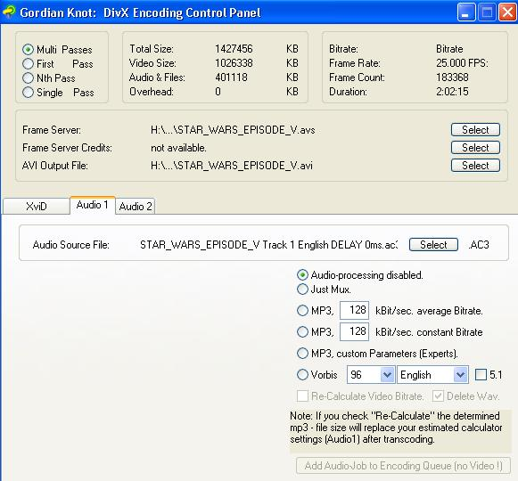

Bu pencerede; radyo butonlarından, `Audio-processing disabled`’ın seçili olmasına dikkat edelim. Ardından `Audio1`’in solundaki `XviD` sekmesini tıklayalım:

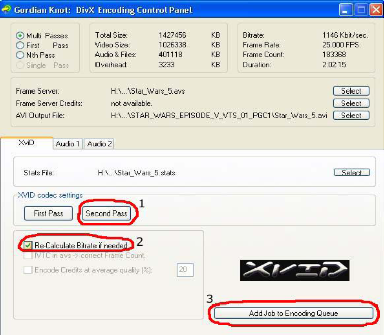

`3 numaradaki` **Add Job to Encoding Queue** butununa basıp Yes dedikten sonra işlemcinin gücüne göre 3-9 saat arası sürecek işlem başlar. 2 numara seçili olacak. Tüm ayarlar bu kadar. Bunun haricinde XviD Second Pass ayarlarını yaparken Target Size’ın 570000 gözüktüğünü, bunun bir öneminin olmadığını, bu konuya sonradan tekrar döneceğimi söylemiştim. Bunun için gerekli olmamakla birlikte 1 numarayla işaretlenmiş Second Pass butonuna tıkladığımızda target size’a, Gordian Knot tarafından otomatik olarak doğru değerin girildiğini görüyoruz:

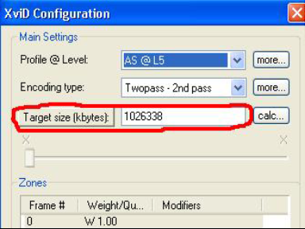

Bu değer, encoding işleminin sonucundak' dosya boyutunu gösterir. Filmi 2 CD yapıyoruz, neden 1400 MB değil derseniz ses dosyasını sonradan ekleyeceğiz. Bu değer filmin ses dosyası hariç kısmının kapasitesidir.

`3 numaradaki` Add Job to Encoding Queue butununa basıp Yes diyerek encoding işlemini başlatalım. XviD codec’i ile encode yapıyorsanız. VirtualDub Mod ile beraber bir başka takip penceresi açılacaktır. VirtualDub Mod ana ekranından `Options > Show Status Window` ile encode işlemini takip edebilirsiniz.

Ayrıca, son model bir sisteminiz yok ise eMule’ü, Azureus’u kapatmanız gerekebilir. Düşük sistemlerde encoding yaparken bilgisayar yavaşlayacaktır. Ancak Gordian Knot ile encode yapmak benim makinamı Dr. DivX ile encode yaparkenki kadar yormuyor. 

Buraya kadar tüm anlattıklarım kendi deneyimlerim. Ayarların bir kısmı kural olarak sabit kalmalıyken kendinizi geliştirdikçe bir kısmını isteğiniz, ilgi alanınız doğrultusunda değiştirebilirsiniz.

### SES EKLEME

Encoding işlemi tamamlandığında sessiz avi dosyamız hazır olacak. Bundan sonraki adımda, Nandub programı ile filmimize ses ekleyeceğiz. Bunun için Nandub programını açalım.

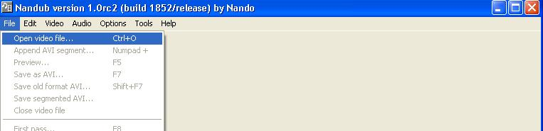

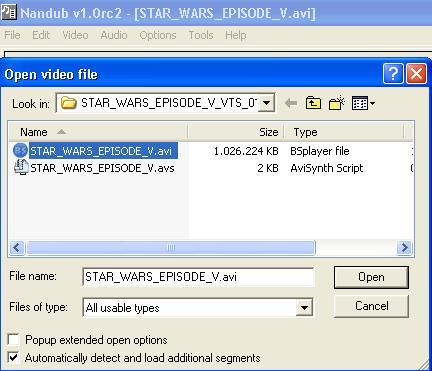

Nandub'da, `Open Video File` ile açılan pencereden `DVD > Projects > Film Adı` klasörünün içinde bulunan avi dosyamızı açalım.

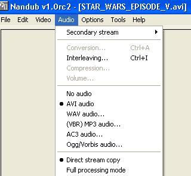

Nandub'da, Audio menüsünü açalım. Ses eklerken, buradaki şıklardan en çok `(VBR) MP3 audio...` ile `AC3 audio`’yu kullanacağız. Ekleyeceğimiz ses dosyası `WAV` veya `Ogg` formatında ise onlar için de şıklar mevcut. Bunun haricinde, `Interleaving...` şıkkı kullanacağımız diğer bir şık. Hazırladığımız filmin çift sesli (Dual Audio) olmasını istersek, ilk sesi ekledikten sonra `Secondary Stream` alt-menüsünü kullanarak, aynı ses ekleme yöntemi ile ikinci sesi ekleyebiliriz. 

Şimdiye kadar adım adım rip’lediğimiz ve encode yaptığımız filmimiz için AC3 ses dosyası hazırlamıştık. Bunun için, Audio menüsünden AC3 audio’ya tıklıyoruz. 

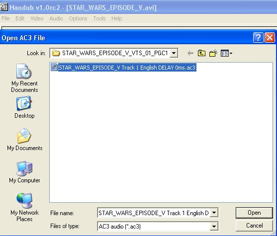

AC3 ses dosyasının yerini genelde otomatik olarak buluyor. Bize yalnızca dosyayı seçip açmak kalıyor. Burada ufak bir not ekleyeceğim. Dosya ismindeki **DELAY * ms** değerini bir kenara not alalım. Bu ses dosyasında delay değeri **0** olsa da başka bazı filmlerin ses dosyasında delay değeri farklı olabilir. Görüntü ile ses arasında, birleştirdikten sonra `senkron kayması olmaması` için, `değer 0’dan farklı ise` ileride interleave yaparken bunu düzeltmemiz gerekecek.

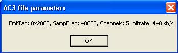

Ses dosyamız açıldı.

Nandub Audio menüsünden `Interleaving` şıkkına tıklıyoruz ve ayarlarını aşağıdaki gibi yapıyoruz. Burada `delay audio track by` kısmına, yukarıda dosya isminde geçen delay değerine göre zıttı bir değer girmemiz gerekiyor. (Örneğin dosya isminde `delay 23ms ise` buraya -`23 değerini` gireceğiz.) 

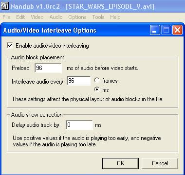

OK deyip çıkıyoruz.

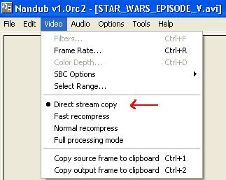

Nandub Video menüsünden `Direct Stream Copy` seçili olacak. Audio menüsünde varsayılan olarak zaten `Direct Stream Copy` seçilidir. 

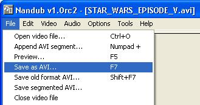

Nandub File menüsünden `Save as avi`'ye basalım.

Farklı bir klasöre farklı bir dosya adı girerek dosyamızı kaydedelim.

Yukarıdaki işlem esnasında görüntü ile ses birleştiriliyor ve 2 CD kapasitesindeki DivX’imiz hazır hale geliyor.

DivX’imiz hazır hale geldikten sonra eksik kalanlar: 

- film cd boyutlarında iki parçaya bölünecek
- vobsub altyazı dosyası aynı yerden ikiye bölünecek.

Devam edelim. Şimdi, filmi böleceğimiz keyframe’i bulmak için VirtualDub Mod programını çalıştıralım ve filmi açalım.

Filmi böleceğimiz yeri bulmadan önce, VirtualDub Mod’daki butonların işlevlerini anlatacağım. 

`1 numaralı buton` ile film dosyasının en başına, `2 numaralı buton` ile en sonuna gidersiniz. `3 ve 4 numaralı butonlar`la bir önceki ve sonraki keyframe’lere atlayabilirsiniz. `5 numaralı buton` ile filmin işlem yapacağınız kısmındaki başlangıç frame’ini ve `6 numaralı buton` ile de işlemin biteceği frame’i belirlersiniz.

Filmi böleceğimiz yer `693 MB ile 698 MB` arasında uygun bir keyframe olmalı. CTRL + G ile filmin ortalarında bir frame’e atlayalım. Ardından 700 MB’ye yaklaştıkça veya geçtiysek 3 ve 4 numaralı butonlarla doğru yeri bulmaya çalışalım.

Filmi böleceğim yeri kırmızı çember içine aldım. Frame değerini ve süreyi -salisesi dahil- kenara not ettim ve VirtualDub Mod’u kapattım. Nandub ile filmi açtım. Şimdi adım adım filmi 2 CD’ye bölüp kaydetme işlemlerini yapalım.

Filmi Nandub'da açtıktan sonra `2 numaralı` butona basalım. `CTRL + J` ile VirtualDub Mod kullanarak bulduğumuz filmin bölüneceği keyframe’e atlayalım. `3 numaralı` butona basalım. Bu şekilde belirlediğimiz başlangıç ve bitiş kısmı Nandub’ın bar kısmında, yukarıdaki gibi mavi renkle görüntülenir. Nandub Audio menüsünde `Interleaving` şıkkındaki ayarlar aşağıdaki gibi olsun.

Bu defa `Delay audio track by *** ms` değeri 0 olarak kalacak.

Audio ve Video menülerinde `Direct Stream Copy`’nin seçili olduğundan emin olalım ve `File > Save as avi`’yi seçelim.

Kırmızı çember içine aldığım kutucuğu işaretleyelim ve dosya ismini farklı girelim, örneğin `Star Wars 5 cd1.avi`. Save’e basınca çember içindeki ayarı seçtiğimiz için işlem başlamak yerine job list’e eklendi. Tekrardan Nandub’ın ana penceresine döndük. 2. CD’yi yapmak için:

1. CD'yi yaparken kaldığımız yerden sırasıyla `1 numaralı` butona ve sonra `3 numaralı` butona basalım. `File > Save as avi` diyerek farklı bir dosya ismi girelim, örneğin `Star Wars 5 cd2` ve `add operation to job list`’i tekrardan seçelim.

Job List’e eklediğimiz işlemleri başlatmak için job list'in kısayolu F4’e basalım.

Start butonuna bastığımızda işlemler başlayacak ve bittiğinde cd’lere kaydedilmeye hazır ikiye bölünmüş filmimiz hazır olacaktır.

### VobSub Bölme

Film dosyasını ikiye böldükten sonra görüntüye senkronlu vobsub altyazı dosyasını ikiye böleceğiz. Bunun için `VobSub Cutter` programını açalım. Programı iki şekilde açabiliriz. İlk olarak, Programı Başlat > Programlar’dan açabiliriz.

İkinci olarak, Gordian Knot ana penceresinden, `Subtitles / Chapters` sekmesinden açabiliriz.

Açılan VobSub: Sub File Cutter penceresinde Open butonuna basalım.

Açılan dosya açma penceresinden .idx uzantılı dosyayı açalım.

İlk CD’nin altyazılarını bölmek için start değerlerini 0 yapalım. End değerleri ise VirtualDub Mod ile belirlediğimiz filmi böldüğümüz yerin zaman değerleri olacak. Kutucuklar resimdeki gibi olsun. Save as ile farklı bir isim vererek 1. CD’nin altyazılarını kaydedelim, Vobsub cutter’ı kapatıp tekrar açalım.

idx dosyasını açtıktan sonra, bu defa Start değerleri önceki End değerleri olacak ve End değerlerine dokunmayacağız. İkinci cd’nin altyazılarını da kaydedelim.

Vobsub altyazımızı ikiye bölme işlemi bu kadar.

İyi seyirler.
