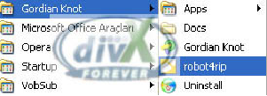
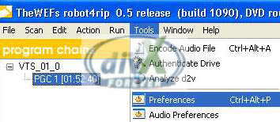
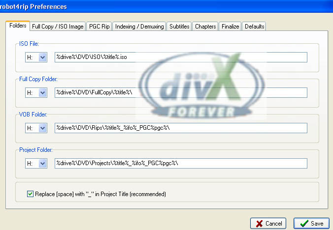
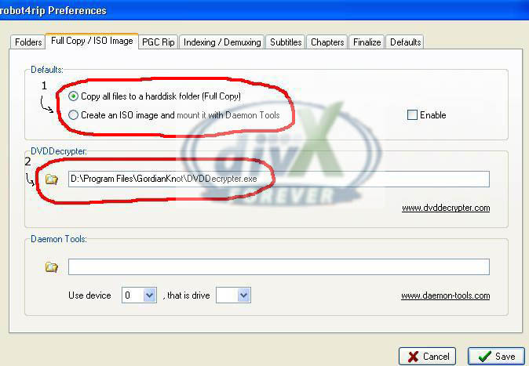
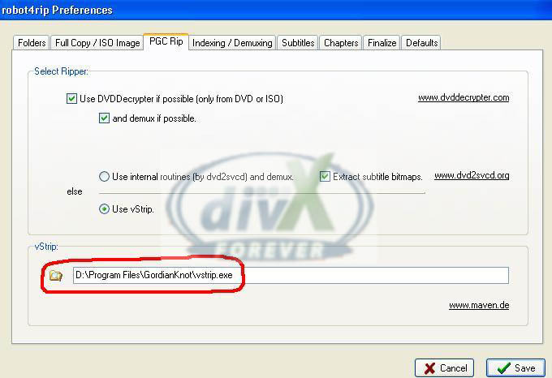

# DVD’DEN DIVX YAPIMI (ADIM ADIM)

## GEREKLİ PROGRAMLAR VE LİNKLERİ

1. [GordianKnot Rip Pack v.0.33.1](http://prdownloads.sourceforge.net/gordianknot/GordianKnot.RipPack.0.33.1.Setup.exe?download )
2. [Gordian Knot Codec Pack 1.9](http://prdownloads.sourceforge.net/gordianknot/Gordian.Knot.Codec.Pack.1.9.Setup.exe?download)

**Gordian Knot Rip Pack içindeki programlar:**

- **Gordian Knot**
	- DVDDecrypter
	- DGIndex
	- VirtualDubMod
	- Nandub
	- robot4rip
	- BeSweet
	- vStrip

**Adım adım izleyeceğimiz yol:**

1. robot4rip’i açıp tüm ayarlarını yapacağız. Ardından seçili ayarlarla robotu çalıştırıp DVD’den DivX’e Encoding için gerekli ön-malzemeyi oluşturacağız.
2. Gordian Knot arayüzü ile gerekli ayarları yapacağız.

---

Rip paketini kurduktan sonra robot4rip’i açalım.

Aşağıdaki şekilde açılacak.

robot4rip'in ana penceresi yukarıdaki gibi. (Programdaki yazılı bilgiler benim son çalışmamdan kalanlar)

İlk kullanımda ayarları yapmamız gerekiyor. Bunun için `Tools > Preferences` yolunu izleyeceğiz.

Preferences ekranı 8 sekmeden oluşuyor. Gordian Knot Rip Pack `v.0.33’teki bir bug’dan dolayı` robot4rip ile kullanacağım tüm entegre programların yolları hatalı gösterilmiş. Adım adım sekmeleri ayarlarken hatalı yolları da (path) kesinlikle düzeltmeliyiz.

Sırasıyla başlayalım. Soldan birinci sekme, `Folders` sekmesinde yaratılacak `ISO dosyası`, `Full Copy` dosyası, `Vob`’ların konulacağı klasör ve proje klasörünün yollarını gösterelim. Burada, kendi makinamda h: sürücüsünün root’unu kök klasör olarak atıyorum. Buradaki klasör atamaları programın default olarak ileride kullandığı klasörler olup sonradan aynı yerden istenildikleri gibi değiştirilmeleri mümkün.

Yukarıdaki resimdeki gibi `Replace [space] with “_” in Project Title (recommended)` seçili olacak.

`Full Copy / ISO Image` sekmesinde, **1** numara ile işaretlenen ayarda DVD’deki dosyaları harddiske `tam kopya` mı alacağımızı yoksa `Daemon Tools` ile `ISO image`’ini mi yapacağımızı seçiyoruz. Resimdeki gösterildiği gibi `Copy all files to a harddisk folder (Full Copy)` seçili olacak. **2 numara** ile işaretlenen ayarda, DVD dosyalarını DVD’den HDD’ye çıkaracak `DVDDecrypter.exe` programının diskteki yolunu doğru gösterelim. Bunun için adresin solundaki küçük klasör ikonuna tıklamamız yeterli. Altındaki `Daemon Tool` ayarlarını ellemiyoruz.

