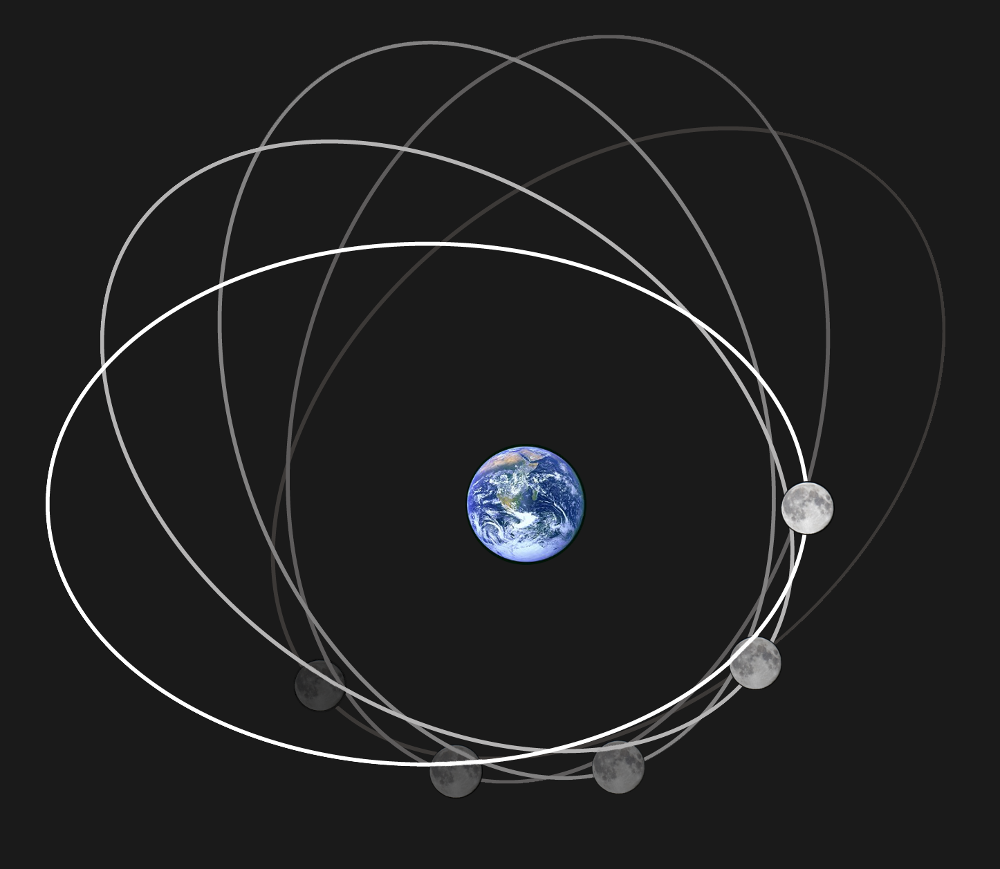
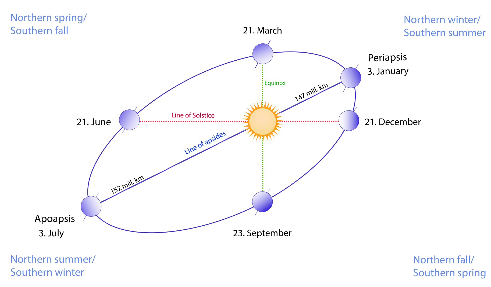
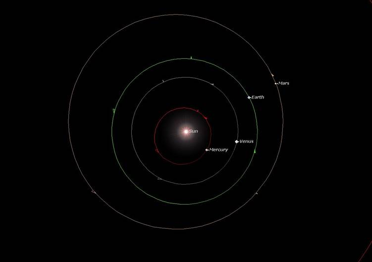
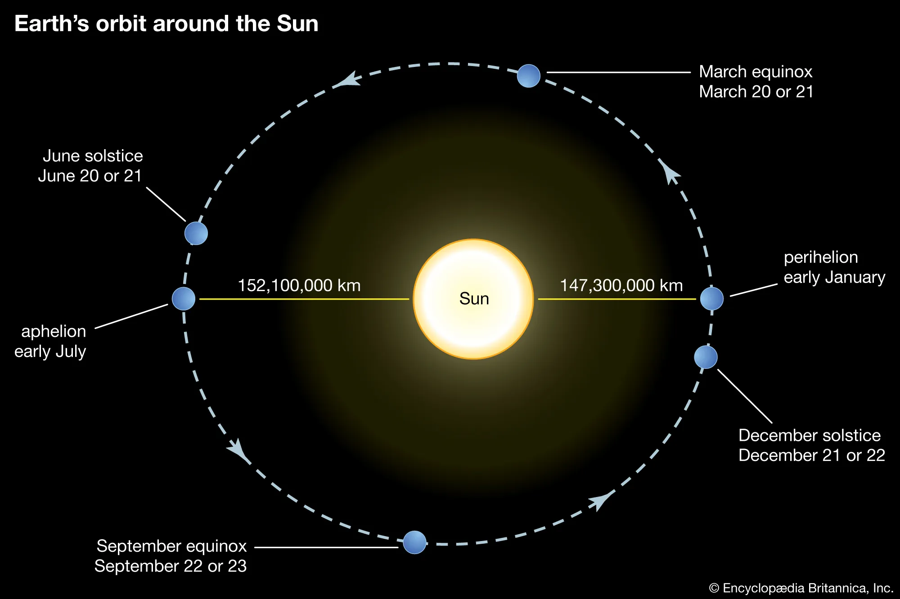
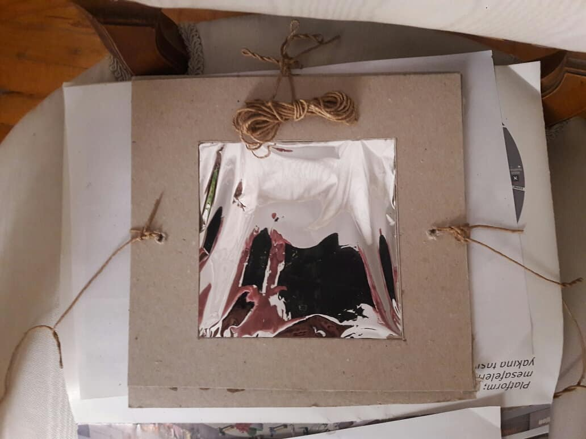
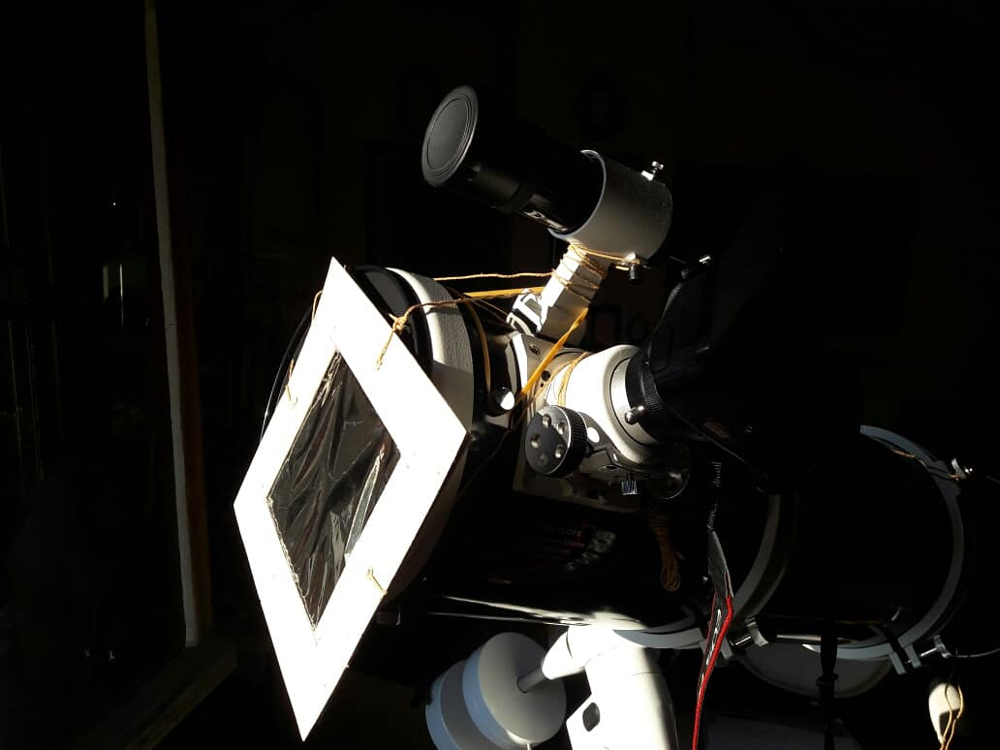
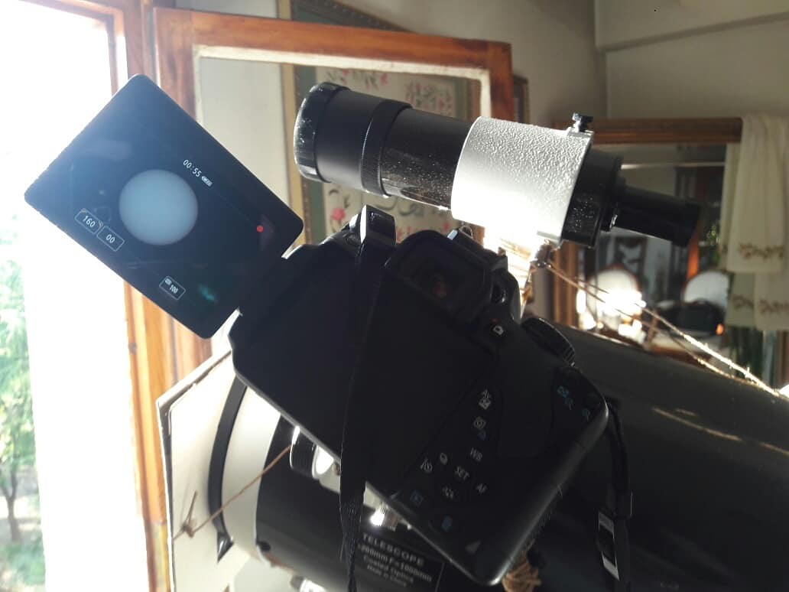
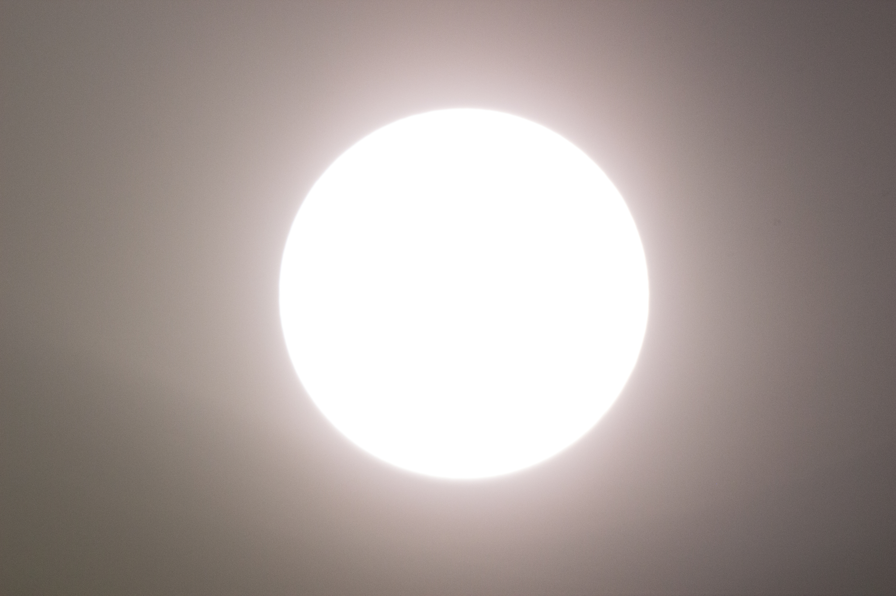
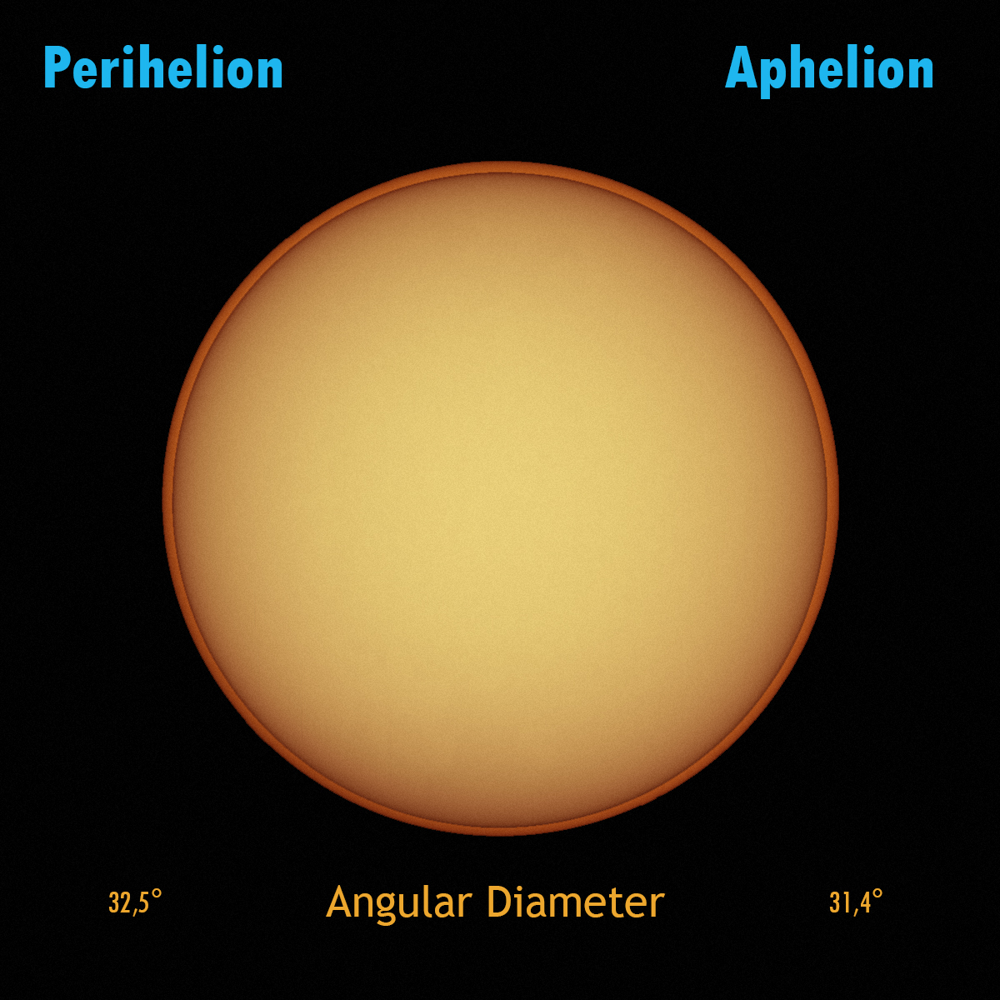
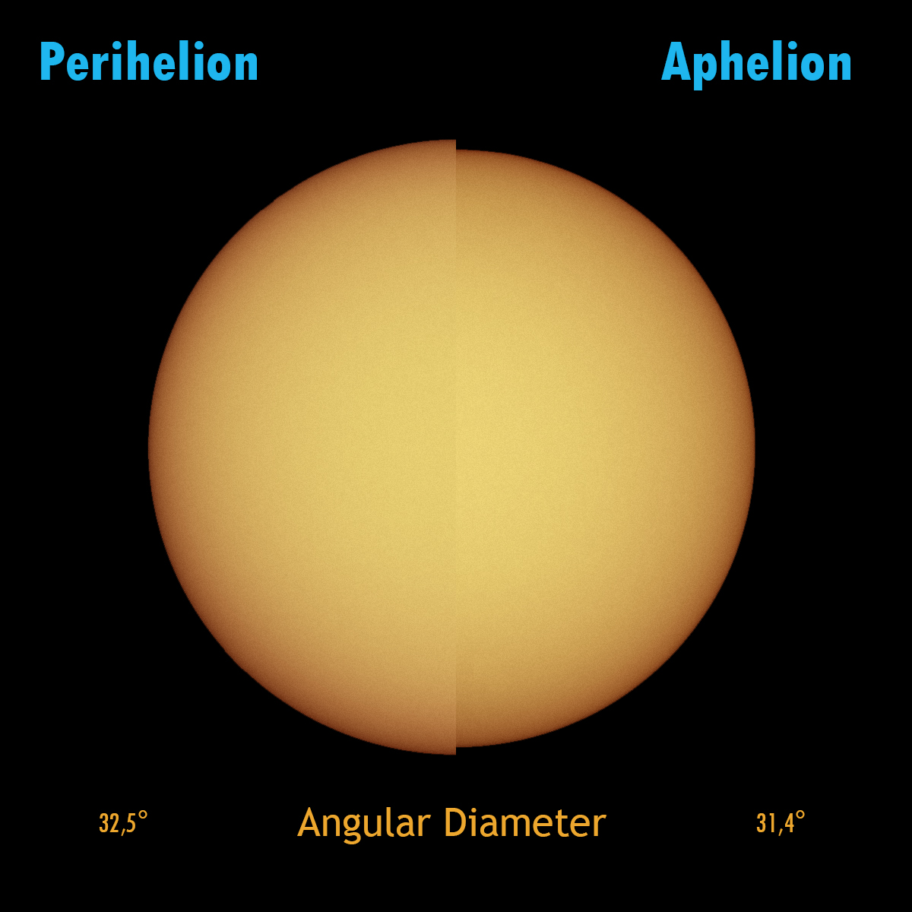

# Güneş'in Gökyüzünde Değişen Görünür Büyüklüğü

## Giriş
Gökyüzünde bize en tanıdık iki cisim için zorlanmadan Güneş ve Ay'dır diyebiliriz. Yıldızlar, asterizmler ve takımyıldızlarını da bilebiliriz ancak çoğunu isimleri ile bilmeyiz. Geceleri Ay'a baktığımızda Ay'ın evrelerinin olduğunu henüz çok küçük yaşta öğreniriz. Ancak Ay'ın gökyüzünde zaman zaman daha büyük ya da daha küçük göründüğünü farketmek için daha keskin bir gözlemci olmak gerekir. Buradaki daha büyük olma hali Ay doğarken ve ufka yakınken bir göz yanılsaması olarak Ay'ı daha büyük algılamamızdan farklı bir durumdur. Biri algısal bir yanılsamayken diğerinde Ay bize gerçekten daha yakın ya da daha uzak olduğu için gökyüzünde daha büyük ya da daha küçük görünür. Her şeye bir isim takma adeti bulunan batılılar Ay'ın en büyük göründüğü haline Süper-Ay, en küçük göründüğü haline ise Mikro-Ay demişler. Ay'ın gökyüzündeki görünür boyutundaki bu değişim Dünya çevresindeki yörüngesinin elips şeklinde olmasından kaynaklanır. Yörünge düzlemi boyunca 1 tam tur atarken Ay Dünya'ya yaklaşır ve uzaklaşır. En yakın olduğu konuma yerberi (perigee), en uzak olduğu konuma da yeröte (apogee) denilir.

<figure>
  
  <small>Ay'ın Eliptik Yörüngesindeki Apsis Hareketi</small>
  <a href="#sectionileriokuma">[1]</a>
</figure>

Şimdi buraya kadarki üzerinden kısaca geçtiğimiz astronomi bilgimizi Güneş'e uyarlarsak, Dünya Güneş'in çevresindeki dönerken Güneş de gökyüzünde büyüyüp küçülüyor mudur?

Gene eski bilgilerimizden hatırlayacak olursak Dünya'nın Güneş çevresindeki yörüngesi de, aynı Ay'ın Dünya çevresindeki yörüngesinde olduğu gibi eliptiktir. 

<figure>
  
  <small>Mevsimler</small>
</figure>

Her ne kadar Dünya'nın yörüngesi eliptik olsa da yörünge dışmerkezliği (eccentricity) 0.0167 gibi çok düşük bir değerdedir. Dünya'nın yörüngesi aslında kusursuz bir çembere çok yakındır. Eğer, bir kağıdın üzerine Dünya'nın yörüngesini muntazam şekilde çizseydik gözümüz bunu mükemmel bir çemberden ayırt edemezdi. Güneş Sistemi'ndeki gezegen yörüngeleri ile ilgili genel bir fikir edinmek için Dünya'nın yörünge dışmerkezliğini diğer gezegenlerin yörünge dışmerkezlik değerleri ile karşılaştırabiliriz. Buna göre; Venüs'ün dışmerkezliği 0.0068 ile Dünya'dan bile daha çemberken, Mars'ınki 0.0934 ve Merkür'ün ise 0.2056 gibi çok daha eliptik değerlere sahiptir.

<figure>
  
  <small>Güneş Sistemi İç Gezegen Yörüngeleri | <a href="https://centerplanetarysciences.org/mars-research/orbit-of-mars/">centerplanetarysciences.org</a></small>
</figure>

Dünya'nın dışmerkezliği çok düşük olsa da, astronomik ölçekte bu çok düşük değer önemli farka neden olur. Dünya yörüngesinde Güneş'e en yakın olduğu günberi (perihelion) noktasında yıldızına uzaklığı 147.1 milyon km'yken en uzak olduğu günöte (aphelion) noktasında 152,1 milyon km'dir. Dünya, Güneş çevresindeki yörüngesinde her 1 turda Güneş'e 5 milyon km. yaklaşıp uzaklaşmaktadır. Bu mesafe Güneş'e ortalama (mean distance) uzaklığının yaklaşık %3,3'üne karşılık gelir ve bunun bir sonucu olarak Güneş de aynı Ay gibi gökyüzünde dönemsel olarak büyür ve küçülür.

<figure>
  
  <small>Dünya'nın Güneş Çevresindeki Yörüngesi | <a href="https://www.britannica.com/topic/How-Far-Is-the-Sun-from-Earth">Britannica</a></small>
</figure>

> [Dünya'nın Gerçek Zamanlı Güneş'e Uzaklığı](https://realtimesolarsystem.com/en/planets/earth/distance-from-sun/)

Gözlem noktamızdan baktığımızda üç boyutlu derinliği doğrudan algılayamadığımızdan gökyüzündeki cisimlerin büyüklüklerini açısal olarak ölçmekteyiz. Dünya, tam 1 tur attığı sürede Güneş'e uzaklığının nasıl %3.3'ü kadar yaklaşıp uzaklaşıyorsa gökyüzündeki açısal büyüküğü de ortalama büyüklüğünün %3.3'ü oranında değişir. Dünya Güneş'e en yakın olduğu günberi (perihelion) noktasından, kış ekinoksundan yaklaşık 10 gün kadar sonra 3 Ocak gibi geçer. Bu sırada Güneş'in gökyüzündeki açısal büyüklüğü `32' 32"` (32 yaydakikası 32 yaysaniyesine)  ulaşır. En uzak günöte (aphelion) noktasından ise yaz ekinoksundan yaklaşık 10 gün kadar sonra 3 Temmuz gibi geçer ve bu konumdayken 31' 28" açısal büyüklüktedir. (Tek tırnak ' yaydakikası, çift tırnak " yaysaniyesi için kullanılır. 1 derece 60 yaydakikasına ve 60 yaysaniyesi 1 yaydakikasına eşittir. 3600 yaysaniyesi 1 derecedir) Güneş günberi ve günöte noktaları arasında gökyüzünde 1 yaydakikası ya da 1 derecenin 1/60'ı kadar büyür ve küçülür. Bu açısal büyüklük tam da insan gözünün algılayabildiği en küçük açısal farka karşılık gelir.

## Amatör Astronominin Sürece Dahil Olduğu Nokta

> Bu çalışmaya kışın 11 Ocak 2020'de Dünya yörüngesinde Güneş'e en yakın konuma geldiğinde Güneş'i çekerek başladım. Yazın 5 Temmuz 2020'de Dünya Güneş'e en uzak konumdan geçerken tamamladım. En yakın ve en uzak konumları arasında Güneş'in gökyüzündeki açısal büyüklüğü 32.5 yay dakika ile 31.4 yay dakika arasında değişiyor. Çalışmadaki amacım Güneş'in açısal büyüklüğündeki bu 1.1 yay dakikalık farkı hazırladığım çeşitli grafiklerle göstermekti.
>
> 24 Temmuz 2020 İstanbul (Çalışma dosyalarını son kez drive'a yüklerken)

Teleskop ile doğrudan Güneş'e nişan almanın sonuçları tesadüfe yer bırakmayacak şekilde son derece trajiktir. Okülerden bir anlık bile bakmak, retinada kalıcı hasara ve ciddi ya da kalıcı görme kaybına yol açabilir. Güneş gözlemi yapmak için gözlem amacına uygun farklı türde filtreler kullanılır. Bu filtreler her zaman teleskobun ön açıklığına (aperture) takılır. Bu sayede okülerden Güneş gözlemi yapmak sağlıklı ve risksiz hale gelir. Amatör astronomlarca en yaygın kullanılan iki filtre türü `Beyaz Işık Filtresi` ile `H-Alpha Filtresi`'dir. H-Alpha Filtresi bu yazının konusu dışında olduğundan ilgilenenler bu filtre türü ile ilgili ayrıca araştırma yapabilirler. 

Beyaz Işık Filtresi Güneş'in fotosferini (görünür yüzey) gösterir. Bu filtre ile Güneş diski ve yüzeyi, yüzeyindeki lekeler görüntülenebilir. 

Beyaz Işık Filtreleri astronomi gereçleri satan adreslerden ya da astronomi forumlarındaki güven duyulan satıcılardan çok daha ucuza alınabilir.

> Beyaz Işık Filtremi ilk teleskobumu aldıktan kısa bir süre sonra üyesi olduğu bir yerli astronomi forumundaki Satış bölümünden almıştım. Bu forumda, o tarihte Türkiye'de amatör astronomi dendiğinde ilk akla gelen isimler aktif olarak yazışıyorlardı ve onlardan onay almış filtreyi almaktan çekinmedim ancak bu filtre takılıyken, kullandığım süre boyunca asla çıplak gözle okulerden Güneş'e bakmadım. Her zaman kamera kullandım. Teleskobun açıklığına sıkıca oturtmak için karton ve ipi kendim ekledim.

<figure>
  
  <small>Baader Beyaz Işık Filtresi.</small>
</figure>

<figure>
  
  <small>Teleskopun ön açıklığına sabitlenmiş Beyaz Işık Güneş Filtresi.</small>
</figure>

<figure>
  
  <small>Fotoğraf Makinesi Elektronik Vizöründe Güneş</small>
</figure>

Nasıl kayıt aldığım ve aldığım kayıtları nasıl işlediğim konuları başka yazının konuları olduklarından onları geçiyorum.

## Karşılaştırmalar

Başlarken ilk amaç teleskobu tam olarak Güneş'e doğrultmak ve kameranın elektronik vizörüne Güneş'i düşürmek. Bu nedenle ilk başta uzun enstantane ve yüksek ISO, Güneş'i vizörde bulmayı kolaylaştırır. 

### Parlak Güneş
<figure>
  
  <small>Başlarken henüz enstantane ve ISO ayarları yapılmadığından yüzeyi seçilemeyecek kadar parlak çıkan Güneş</small>
</figure>

Artık sonuç bölümüne geçebiliriz. Bundan sonraki fotoğraflar bu yazının yazılma amacını oluşturan fotoğraflar. 

### Üst üste bindirilmiş en küçük ve en büyük Güneş
<figure>
  
  <small>Başlarken henüz enstantane ve ISO ayarları yapılmadığından yüzeyi seçilemeyecek kadar parlak çıkan Güneş</small>
</figure>

### Yarılardan yan yana hizalanmış en küçük ve en büyük Güneş
<figure>
  
  <small>Başlarken henüz enstantane ve ISO ayarları yapılmadığından yüzeyi seçilemeyecek kadar parlak çıkan Güneş</small>
</figure>

---

> Teleskoptan ilk defa bakanların ve bir amatör teleskop satın alıp onunla gökyüzüne bakanların %80'i büyük hayalkırıklığına uğrar. Gördüklerinin görmeyi bekledikleri Hubble ve James Webb Uzay Teleskopları'nın çektiği fotoğraflarla uzaktan yakından ilgisi yoktur. O küçücük üzerinden bir çizgi geçen bej şey Satürn işte. O çizgi de halkaları. O küçücük bej şeyin gerçekten Satürn olduğunu ayırt ettiğinizde amatör astronomi ve teleskobun büyüsü başlar. Yaptığınız gözlemler hayalgücünüzle desteklenmeli ve şekillendirilmelidir. Bu nedenle teleskoptan baktığında hayalkırıklığına uğramayan ve gökyüzünün büyüsünü duyanlar ağırlıklı olarak teleskop almadan önce çıplak gözle gökyüzünü çoktan öğrenmiş olanlar arasından çıkar.

<h2 id="sectionIleriOkuma">İleri Okuma</h2>

[1]: [Ay'ın Apsis Hareketi](https://en.wikipedia.org/wiki/Apsidal_precession)

