---
title: "The Sun's Changing Apparent Size in the Sky"
description: "An amateur telescope photography study illustrating how the Sun's angular size in the sky varies seasonally."
owner: "Berk Acunas"
version: "1.0"
last-edited: "2026-11-26"
translation:
  source-language: "tr"
  target-language: "en"
  method: "smart-ai assisted"
format:
  html:
    include-in-header:
      - text: |
          <meta content="https://berkacunas.github.io/assets/images/astronomy/changing-apparent-size-of-the-sun-in-the-sky-the/cover-sun-image.jpg" property="og:image">
---
*Also available in [Turkish](/tr/articles/astronomy/changing-apparent-size-of-the-sun-in-the-sky-the.md).*

## Purpose of the Study
In this study, it is aimed to photograph the Sun with a telescope on the dates when the Earth is closest to and farthest from the Sun in its orbit around the Sun, and to visualize the change in the star's diameter through a comparison of these photographs. The photographs in the study were taken with a Canon EOS 650D camera, attached to a Skywatcher 8" Explorer reflector telescope using the prime-focus method, with a Baader White Light Solar Filter attached to the front aperture of the telescope.

## Starting With Our Moon as an Easier Target
We can easily say that the two most familiar celestial bodies in the sky are the Sun and the Moon. We can also recognize stars, asterisms, and constellations, but we don't know most of them by name. When we look at the Moon at night, we learn at a very young age that the Moon has phases. However, one needs to be a sharper observer to notice that the Moon sometimes appears larger or smaller in the sky. This state of being larger here is a different situation from the Moon illusion, where we perceive the Moon as larger when it rises and is close to the horizon. In one, it's a perceptual illusion, while in the other, the Moon appears larger or smaller in the sky because it is actually closer or farther away from us. In the modern age, as astronomy developed, they called the Moon the Supermoon when it appeared largest, and the Micromoon when it appeared smallest. This change in the Moon's apparent size in the sky is due to its elliptical orbit around the Earth. The Moon approaches and recedes from Earth as it completes one full orbit along its orbital plane. The position closest to it is called perigee, and the position farthest from it is called apogee.

<figure>
  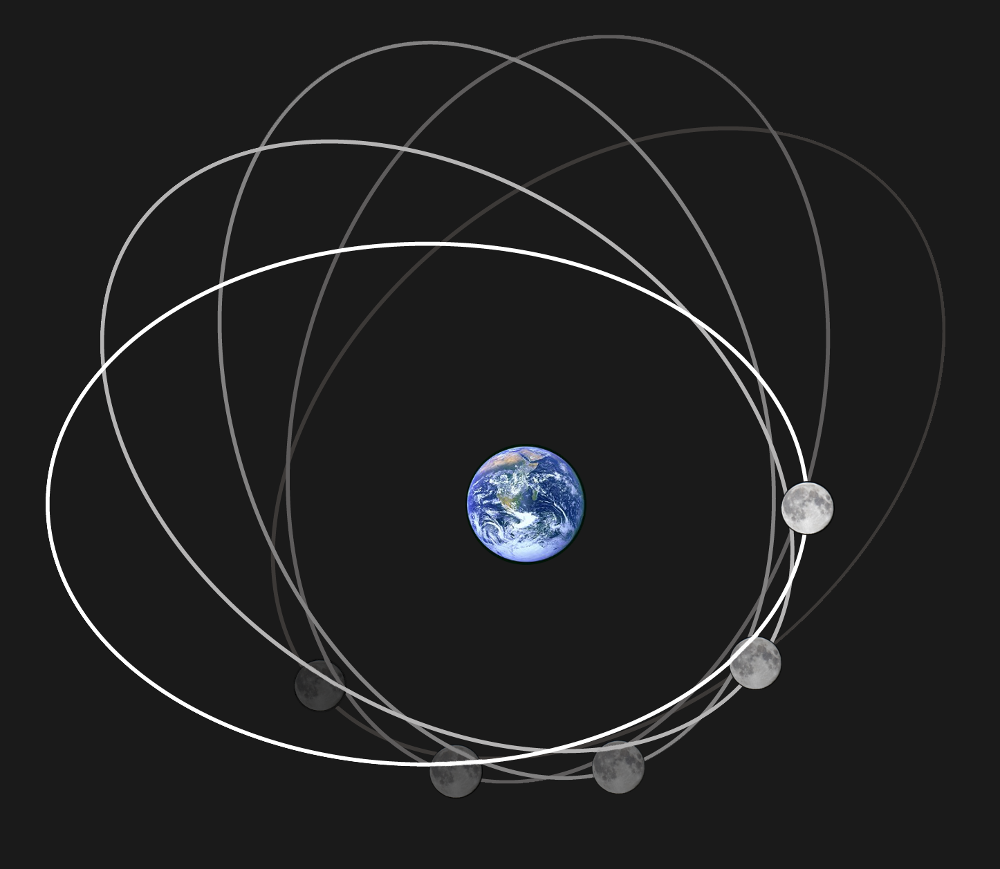
  <small>The Elliptical Orbit and Apsidal Precession of the Moon</small>
  <a href="#sectionfurtherreading">[1]</a>
</figure>

## The Earth's Orbit Around the Sun
Now, if we adapt our astronomy knowledge, which we have briefly touched upon so far, to the Sun, does the Sun grow and shrink in the sky as the Earth revolves around it?

If we recall from our old knowledge, the Earth's orbit around the Sun is also elliptical, just like the Moon's orbit around the Earth.

<figure>
  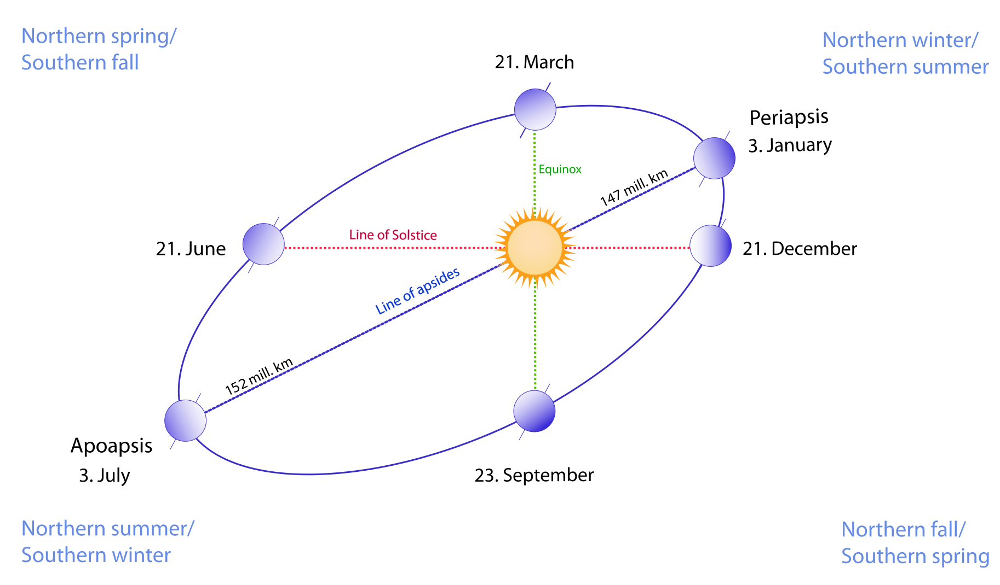
  <small>Seasons</small>
</figure>

Although Earth's orbit is elliptical, its orbital eccentricity is a very low value of 0.0167. The Earth's orbit is actually very close to a perfect circle. If we were to draw the Earth's orbit on a piece of paper in a regular manner, our eyes would not be able to distinguish it from a perfect circle. To get a general idea about the planetary orbits in the Solar System, we can compare Earth's orbital eccentricity with the orbital eccentricity values of other planets. Accordingly; Venus's eccentricity is 0.0068, which is even more circular than Earth's, while Mars's has a much more elliptical value of 0.0934, and Mercury's is 0.2056.

<figure>
  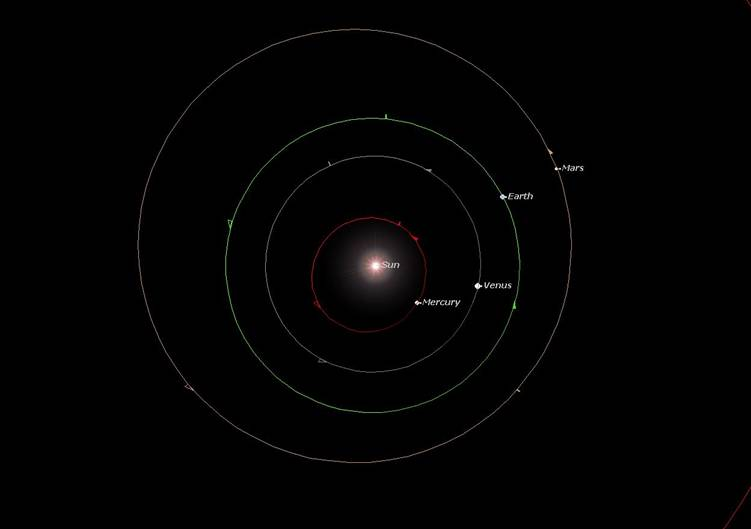
  <small>Inner Planet Orbits of the Solar System | <a href="https://centerplanetarysciences.org/mars-research/orbit-of-mars/">centerplanetarysciences.org</a></small>
</figure>

Although Earth's eccentricity is very low, this very low value causes a significant difference on an astronomical scale. At its `perihelion`, when Earth is closest to the Sun in its orbit, its distance from its star is 147.1 million km, while at its `aphelion`, when it is farthest, its distance is 152.1 million km. The Earth, in its orbit around the Sun, approaches and recedes from the Sun by 5 million km on each orbit. This distance corresponds to approximately 3.3% of the Sun's `(mean distance)`, and as a result, the Sun, like the Moon, periodically appears to grow and shrink in the sky.

<figure>
  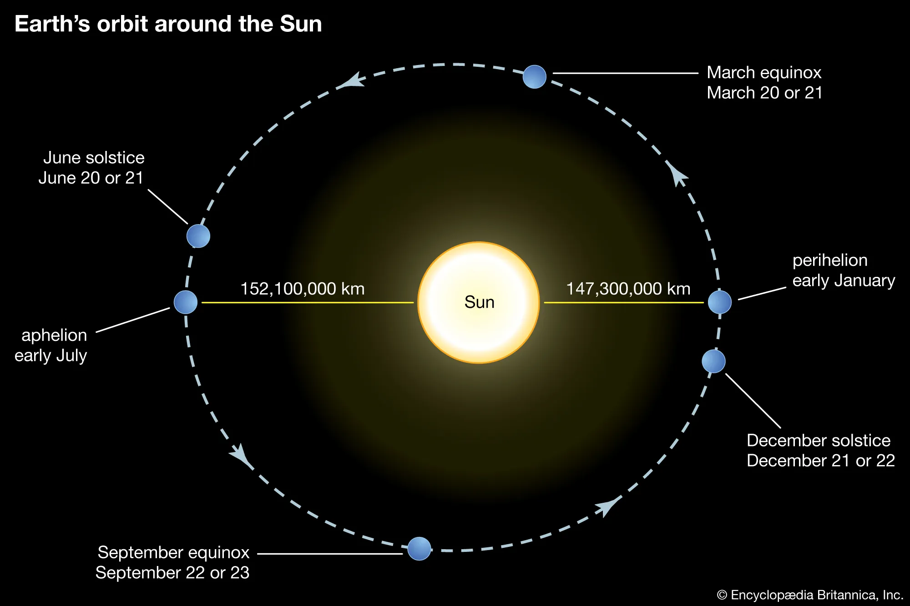
  <small>Earth's Orbit Around the Sun | <a href="https://www.britannica.com/topic/How-Far-Is-the-Sun-from-Earth">Britannica</a></small>
</figure>

> [The Earth's Real-Time Distance from the Sun](https://realtimesolarsystem.com/en/planets/earth/distance-from-sun/)

When we look from our observation point, since we cannot directly perceive three-dimensional depth, we measure the sizes of celestial objects angularly. Just as the Earth approaches and recedes from the Sun by 3.3% of its distance during one full orbit, its angular size in the sky also changes by 3.3% of its average size. The Earth reaches its point closest to the Sun (perihelion) around January 5th, approximately 10 days after the winter solstice. Meanwhile, the Sun's angular diameter in the sky reaches `32' 32"` (32 arcminute 32 arcseconds). It passes around July 3rd, approximately 10 days after the summer solstice, at its farthest point (aphelion) and is at an angular size of 31' 28" in this position. (A single apostrophe ' is used for arcminute, and a double apostrophe " is used for arcseconds. 1 degree equals 60 arcminute, and 60 arcseconds equal 1 arcminute. 3600 arcseconds equal 1 degree.) The Sun grows and shrinks by 1 arcminute, or 1/60th of a degree, in the sky between the perihelion and aphelion points. This angular size corresponds exactly to the smallest angular difference that the human eye can perceive.

## The Point Where Amateur Astronomy Enters the Process
> I started this study by imaging the Sun when Earth reached its closest point to the Sun in its orbit on January 11, 2020, in winter. I completed it on July 5, 2020, when the Earth passed through its farthest point from the Sun. The Sun's angular diameter in the sky varies between 32.5 arcminute and 31.4 arcminute between its closest and farthest positions. The aim of my study was to show this 1.1 arcminute difference in the Sun's angular diameter with various graphs I prepared.
>
> -- July 24, 2020 Istanbul (While uploading work files to Drive for the last time)

The consequences of aiming a telescope directly at the Sun are extremely tragic, leaving no room for coincidence. Looking through the eyepiece, even for a moment, can cause permanent damage to the retina and lead to severe or permanent vision loss. Different types of filters suitable for the observation purpose are used for solar observation. These filters are attached to the telescope's aperture. Thus, solar observation through the eyepiece becomes risk-free and healthy. The two most commonly used filter types by amateur astronomers are the `White Light Filter` and the `H-Alpha Filter`. The H-alpha filter allows live observation of filament structures in the chromosphere -the layer just above the Sun's surface- and since this is beyond the scope of this article, interested readers can explore this type of filter further on their own.

The White Light Filter shows the Sun's photosphere (visible surface). With this filter, the solar disk and surface, including sunspots on its surface, can be visualized.

White Light Filters can be purchased from astronomy shops or from trusted sellers on astronomy forums much cheaper compared to astronomy shops.

<figure>
  
  <small>Baader White Light Filter.</small>
</figure>

> I had bought my White Light Filter from the Sales section of a local astronomy forum I was a member of, shortly after getting my first telescope. In this forum, the names that first came to mind when amateur astronomy was mentioned in Turkey at that time were actively corresponding, and I didn't hesitate to get the filter approved by them, but while this filter was attached, I never looked at the Sun through the eyepiece with the naked eye during the time I used it. I have always used a camera. I added the cardboard and string myself to fit snugly into the telescope's opening.

<figure>
  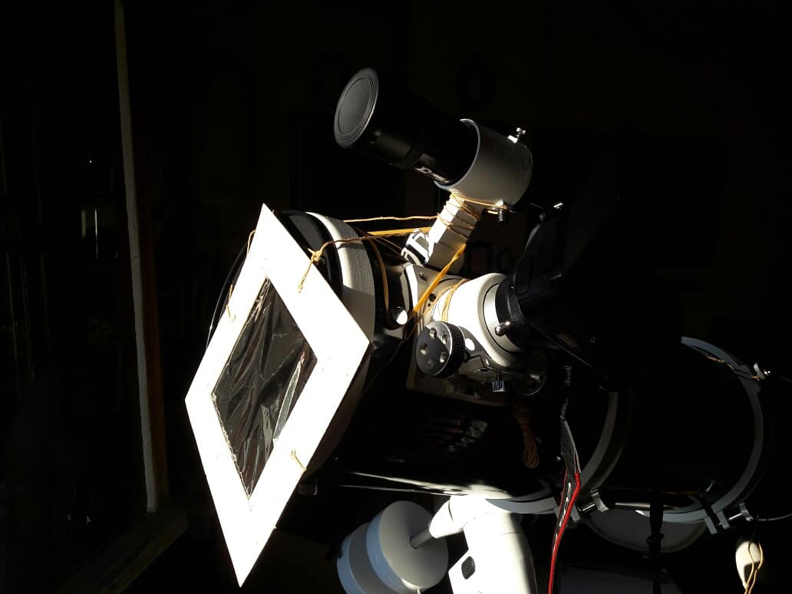
  <small>White Light Solar Filter attached to the front aperture of the telescope.</small>
</figure>

<figure>
  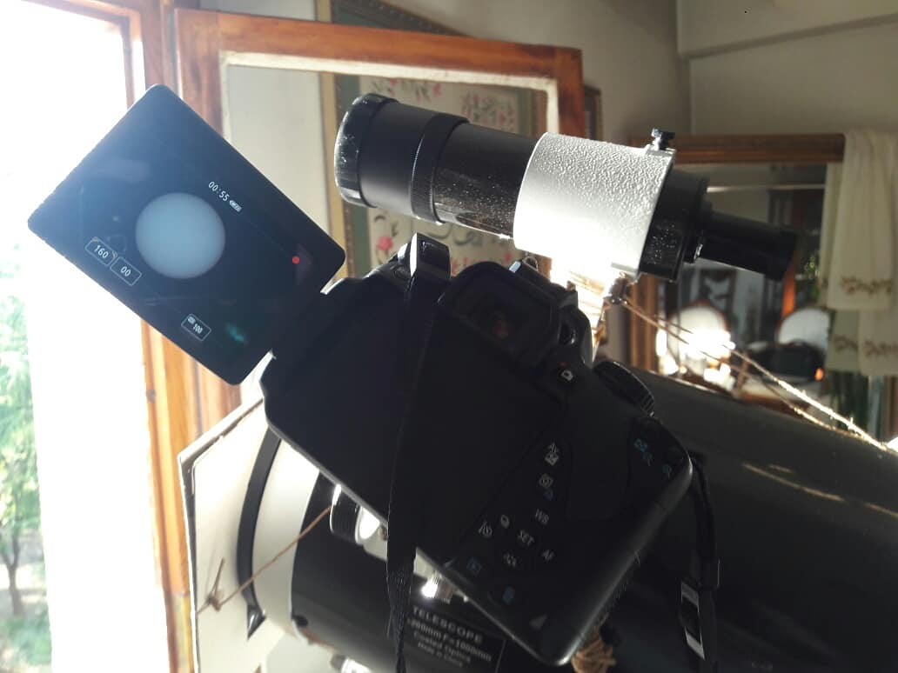
  <small>Sun in the Camera's Electronic Viewfinder attached to Prime-Focus</small>
</figure>

I am skipping the recording and processing methods in this article to avoid diversifying the topic further. Topics broad enough to be the subject of separate articles on both subjects.

## Comparisons
When starting observation, the first aim is to point the telescope exactly at the Sun and to get the Sun into the electronic viewfinder of the camera. Therefore, long exposure and high ISO at first make it easier to find the Sun in the viewfinder.

### Bright Sun

<figure>
  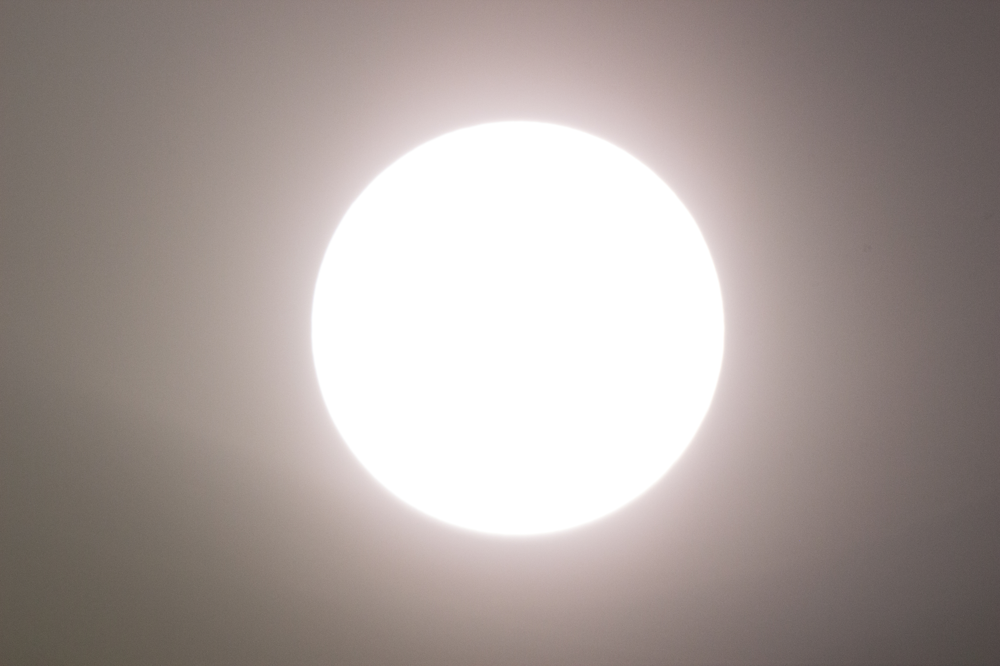
  <small>Sun appearing too bright to discern its surface at the start because shutter speed and ISO settings had not yet been adjusted</small>
</figure>

We can now move on to the conclusion section. After taking the photos from the camera and completing the stacking and format conversion processes, I opened them again in Photoshop. In the photos, the Sun was pure white. I artificially enhanced the color in the following photographs using Photoshop to bring it closer to the color we see with our eyes, with aesthetic considerations.

As is known, the Sun emits light in all colors, and since white is the color where all colors are present together, the color of the Sun is white. The yellowish color we see in the sky with our eyes is formed as a result of the scattering of blue wavelengths from the Sun by the gases in the atmosphere `(Rayleigh scattering)`. The wavelengths of red, orange, and yellow remain dominant in the light that reaches our eyes.

<figure>
  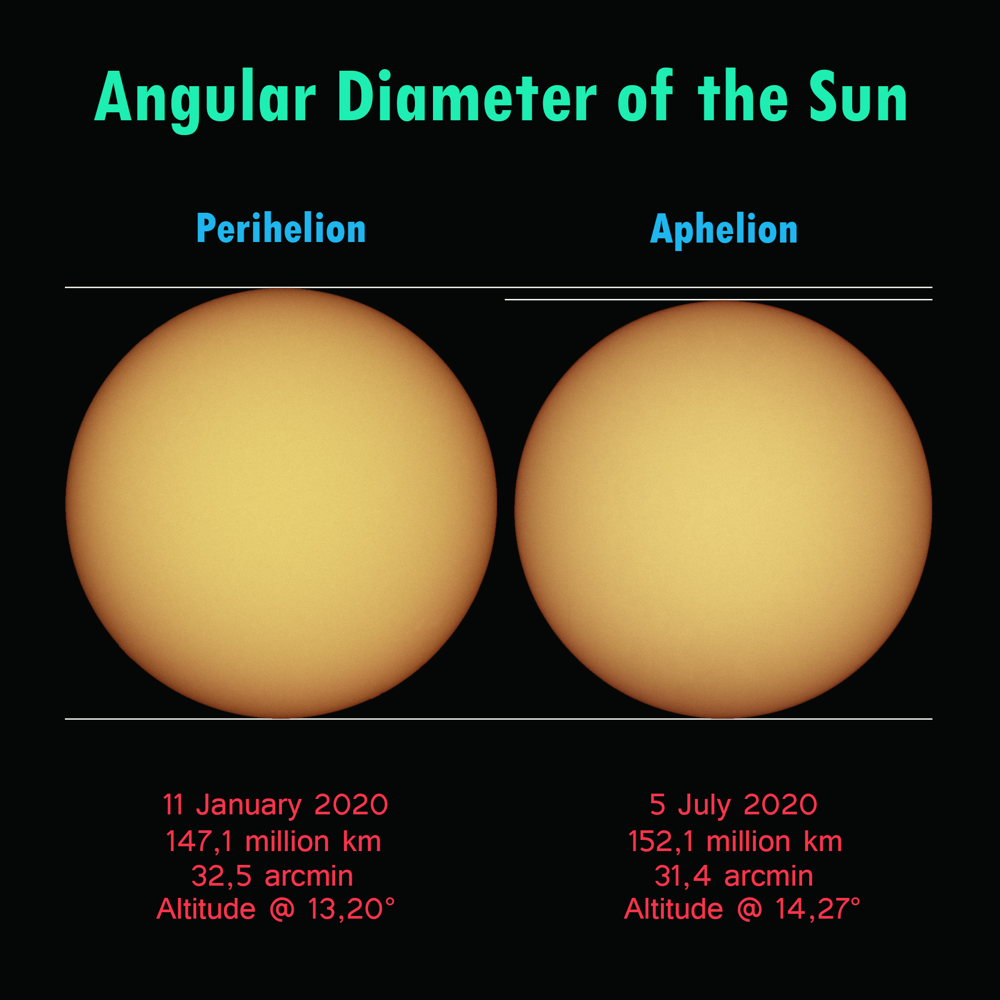
  <small></small>
</figure>

### Farthest and Closest Sun Superimposed
<figure>
  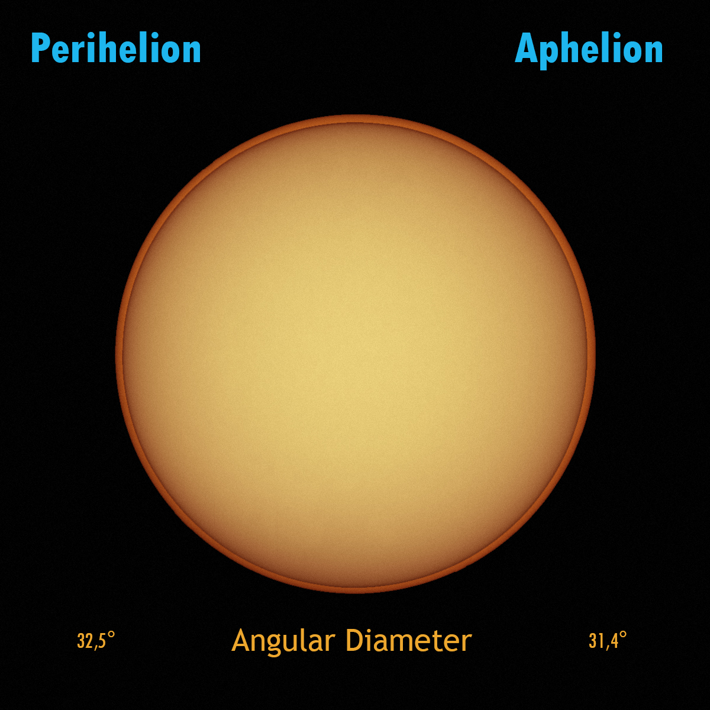
  <small>The Sun in the back is darker to make the size difference apparent.</small>
</figure>

### The farthest and nearest Sun aligned side by side

<figure>
  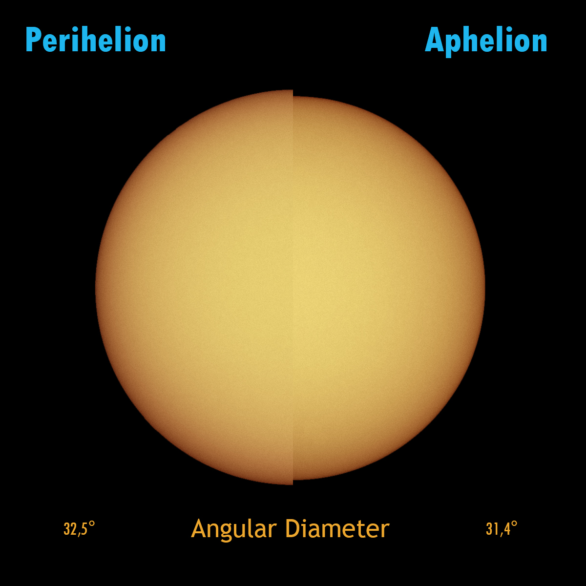
    <small></small>
</figure>

## Adding the Biggest and Smallest Moon to Comparisons
Shall we add the moon to the comparison, too?

<figure>
  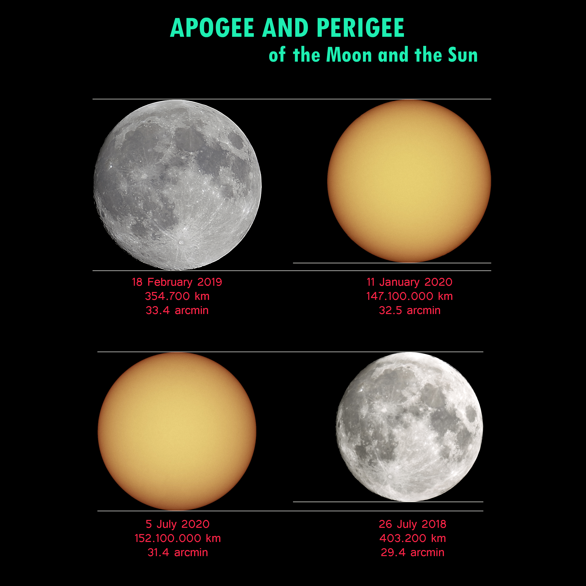
    <small></small>
</figure>

> In the moon photos, the moon is in the phase of the day before the full moon, not the full moon. On the date I did the work, I could not find Moon photos taken in the Full Moon phase in my archive for `super` and `micro` Moon photos. Therefore, I used the photos I took when the Moon was closest and farthest, in its phase closest to the Full Moon.

## Proof of Solar Eclipse Types Using the Closest and Farthest Sun and Moon Photographs Taken

<figure>
  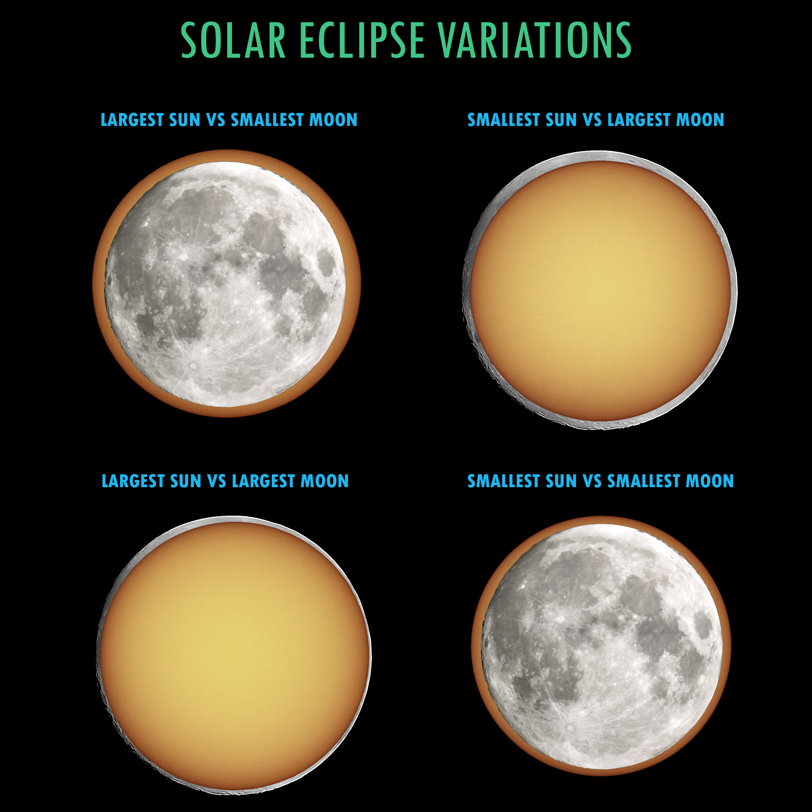
  <small>Types of Solar Eclipse</small>
</figure>

If you'd like, let's go through the types of solar eclipses one by one, using the photo above as a reference:

1. **Total Solar Eclipse:** The Moon must cover the entire Sun. The equivalent in the photograph:
 
    - `Largest Sun vs Largest Moon`
    - `Smallest Sun vs Largest Moon`
     

      **Conclusion:** The Moon is large enough to cover all of the Sun's disk, and for this type of solar eclipse, `the Moon's size is important regardless of the Sun's size`.
 

2. **Annular Solar Eclipse:** Occurs when the Sun is not completely covered by the Moon. The equivalent in the photograph:
 
    - `Largest Sun vs Smallest Moon`
    - `Smallest Sun vs Smallest Moon`
     
      
      **Conclusion:** The smallest phase of the Moon is smaller than the smallest phase of the Sun.
     `When the Moon is small, an Annular Solar Eclipse is inevitable, regardless of the Sun's size`.
 

3. **Partial Solar Eclipse:** In this type of eclipse, the Moon does not pass directly in front of the Sun, and a portion of the Sun is obscured. The terminator line separating the covered part from the exposed part is arc-shaped. The Sun appears in a crescent or semicircular shape. In a partial solar eclipse, the sizes of the Moon and the Sun do not play a direct role.

See you in another study.

November 2026

## Further Reading
[1]: [The Moon's Apsidal Motion](https://en.wikipedia.org/wiki/Apsidal_precession)

-----
*Translated from Turkish with Smartcat AI assistance; reviewed and refined by the author (last edited 26 November 2026, v1.0).*